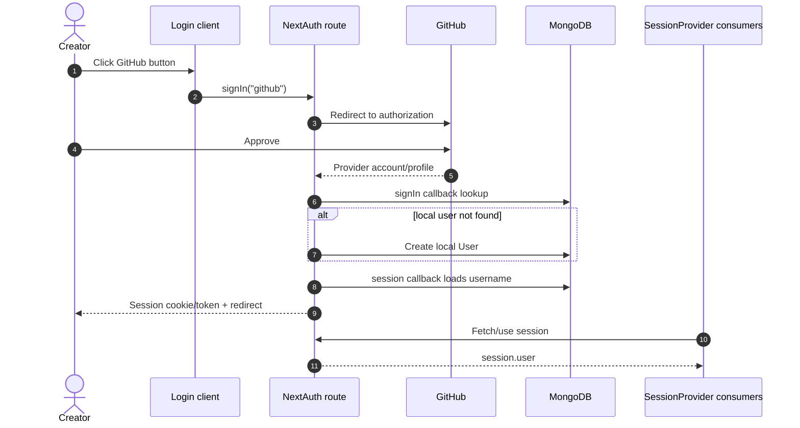

# GetFunds: Complete Project Learning Manual

**Status:** Exhaustive Codebase Audit & Technical Master Document  
**Generated:** 2026-08-29  
**Implementation updated:** 2026-08-30  
**Workspace:** `/Users/divansingh/Desktop/GetFunds`  
**Primary App:** `/Users/divansingh/Desktop/GetFunds/my-app`  
**Stack:** Next.js 15.4.6 (App Router) + React 19.1.0 + MongoDB/Mongoose 8.17.1 + GridFS + NextAuth 4.24.11 + Razorpay Test REST API/Checkout + Tailwind CSS 4 + React Toastify 11.0.5  
**Purpose:** a self-contained, code-grounded learning guide. “Current” means the checked-out source audited on the generated date.

> **Historical branding note:** The original audited code mixed `GetFunds`, `Get Me a Chai!`, and `BuyMeFunds`. The current runtime consistently uses `GetFunds Demo`; older audit passages preserve the original names for learning context.

> [!IMPORTANT]
> **Current implementation update:** The application now uses **Razorpay Test Mode only**. It opens Razorpay's official mock Checkout, creates test orders on the server, verifies HMAC signatures and remote payment fields, and rejects live key IDs. Test Mode never moves real money. The original audit sections below preserve the insecure, incomplete Razorpay implementation as a learning case study; they do not describe the current runtime.

## Current implementation after the refactor

The current project now demonstrates the architecture safely:

- GitHub OAuth provisions users using the correct normalized email and collision-resistant usernames.
- Server sessions expose `user.id` and `user.username` without overwriting the display name.
- The dashboard is protected during server rendering, and profile updates derive ownership from the server session.
- Public creator queries return an explicit safe projection and never serialize email or payment secrets.
- Razorpay Test keys are global server environment variables rather than per-user database secrets; live keys are rejected.
- `POST /api/razorpay/order` validates a contribution, creates a test order, and stores a pending row.
- `POST /api/razorpay/verify` checks HMAC-SHA256 with `timingSafeEqual`, confirms remote payment fields, and completes the row idempotently.
- MongoDB aggregation calculates all-time verified totals, contribution count, unique supporter names, and average amount.
- Creators can edit funding goals; public pages show progress, rankings, and summary metrics.
- Global search recommends creator profiles by username/display-name prefix and similar substring matches.
- Authenticated creators publish project folders; metadata uses Mongoose and file bytes use MongoDB GridFS.
- The creator dashboard shows analytics, top supporter, recent activity, project management, and an explicit target editor.
- Database schemas use timestamps, validation, unique indexes, immutable creator references, and cached connections.

**New interview features:** verified Razorpay Test lifecycle, creator discovery, editable goals, aggregate analytics, and GridFS project portfolios.

The earlier Razorpay discussion remains useful for comparing the original broken callback design with the current signed Test Mode implementation. The project still makes no claim that it processes production payments.

---

## TABLE OF CONTENTS
1. [Executive Summary](#1-executive-summary)
2. [Tech Stack — Deep Dive](#2-tech-stack--deep-dive)
3. [Project Structure — Full Tree](#3-project-structure--full-tree)
4. [Environment & Secrets](#4-environment--secrets)
5. [Architecture Overview](#5-architecture-overview)
6. [Routing Map](#6-routing-map)
7. [Data Layer — Mongoose Models](#7-data-layer--mongoose-models)
8. [Database Connection](#8-database-connection)
9. [Auth Flow — End to End](#9-auth-flow--end-to-end)
10. [Payment Flow — End to End](#10-payment-flow--end-to-end)
11. [File-by-File Breakdown — EVERYTHING EXPLAINED](#11-file-by-file-breakdown--everything-explained)
12. [Server Actions Deep Dive](#12-server-actions-deep-dive)
13. [UI/UX Breakdown](#13-uiux-breakdown)
14. [Security Audit — CRITICAL](#14-security-audit--critical)
15. [Bugs, Code Smells & Logic Flaws (with file:line)](#15-bugs-code-smells--logic-flaws-with-fileline)
16. [Missing Pieces — What Does NOT Exist But Should](#16-missing-pieces--what-does-not-exist-but-should)
17. [Performance & Scalability Notes](#17-performance--scalability-notes)
18. [Setup & Run Guide (Local)](#18-setup--run-guide-local)
19. [Deployment Guide](#19-deployment-guide)
20. [Interview Guide — What Interviewers Will Ask](#20-interview-guide--what-interviewers-will-ask)
21. [Interview Challenges & Q&A (from PDFs)](#21-interview-challenges--qa-from-pdfs)
22. [Unrelated Artifact — AgenticAI Notebook](#22-unrelated-artifact--agenticai-notebook)
23. [Production Roadmap — What To Build Next](#23-production-roadmap--what-to-build-next)
24. [Appendix A — Dependencies Explained](#24-appendix-a--dependencies-explained)
25. [Appendix B — Line 15 Answer](#25-appendix-b--line-15-answer)
26. [Appendix C — Git & Project Hygiene](#26-appendix-c--git--project-hygiene)
27. [Learning Foundations — Terms Used by This Codebase](#27-learning-foundations--terms-used-by-this-codebase)
28. [Next.js Rendering and Execution Boundaries](#28-nextjs-rendering-and-execution-boundaries)
29. [Authentication — Detailed Request Trace](#29-authentication--detailed-request-trace)
30. [MongoDB and Mongoose — Detailed Model Trace](#30-mongodb-and-mongoose--detailed-model-trace)
31. [Server Actions — Detailed Contracts and Risks](#31-server-actions--detailed-contracts-and-risks)

---

## 1. Executive Summary

**GetFunds** is a **creator crowdfunding platform** — a clone of *Buy Me a Coffee / Get Me a Chai*. 

- **Creators** authenticate via **GitHub OAuth (NextAuth)**.
- Each creator gets a **public profile** at `/[username]` that shows cover/profile images, donation stats, supporter leaderboard, and a payment form.
- **Fans** (no login required) can donate any amount + name + message via **Razorpay Checkout**.
- Creators manage profile, avatar URLs, and **own Razorpay credentials (key_id + key_secret)** per-user from `/dashboard`.
- Payments are stored in MongoDB with `done` flag, ordered by amount descending (Top 10).
- Stack is modern: **App Router**, **Server Actions**, **Client Components with `useSession`**, **Mongoose**.

**Current State:** Partially functional MVP and **not production-ready**. Public pages and Razorpay order initiation exist, but verified payment completion is absent. The local environment contains secret-bearing values and is correctly ignored by the nested `.gitignore`; the more immediate code leak is that public `fetchuser` serializes the creator's stored `razorpaysecret` to the client.

---

## 2. Tech Stack — Deep Dive

| Layer | Choice | Version | Why It’s Used / Notes |
|-------|--------|---------|-----------------------|
| **Framework** | Next.js App Router | 15.4.6 | File-based routing, Server Actions, `app/` dir, `generateMetadata`, `notFound()` |
| **UI Library** | React | 19.1.0 | Latest React; client components use `"use client"` |
| **Auth** | NextAuth.js | 4.24.11 | GitHub OAuth, `SessionProvider`, `signIn`/`signOut`, callbacks `signIn` + `session` |
| **DB** | MongoDB + Mongoose | 8.17.1 | `User` & `Payment` schemas, `connectDB` helper |
| **Payments** | Razorpay SDK | 2.9.6 | `instance.orders.create()`, checkout.js on client |
| **Styling** | Tailwind CSS | 4 (+ `@tailwindcss/postcss` 4) | `globals.css:1` is just `@import "tailwindcss";` — no custom utilities |
| **Notifications** | React Toastify | 11.0.5 | `Bounce` transition, `ToastContainer` duplicated bug |
| **Fonts** | `next/font/google` | Geist + Geist_Mono | Loaded in `app/layout.js:1,7-15` |
| **Lint** | ESLint + `eslint-config-next` | 9 + 15.4.6 | `eslint.config.mjs:12` extends `next/core-web-vitals` |
| **Build** | `postcss.config.mjs` | — | Single plugin `["@tailwindcss/postcss"]` |

**Node Scripts** (`package.json:5-10`):
- `dev`: `next dev` → localhost:3000
- `build`: `next build`
- `start`: `next start`
- `lint`: `next lint`

---

## 3. Project Structure — Full Tree

```
/GetFunds/
├── AgenticAI_1BM23CD017.ipynb       # UNRELATED: Agentic AI TravelAgent assignment
├── GetFunds_Interview_Technical_Guide.pdf
├── GetFunds_Interview_Challenges_QA.pdf
├── README.md                       # 2 lines only
├── my-app/                         # ← MAIN NEXT.JS APP
│   ├── .env.local                  # SECRETS (LEAKED - see Security)
│   ├── .gitignore
│   ├── eslint.config.mjs
│   ├── jsconfig.json               # path alias "@/*": ["./*"]
│   ├── next.config.mjs             # empty {}
│   ├── package.json / package-lock.json
│   ├── postcss.config.mjs
│   ├── db/
│   │   └── connectDB.js            # mongoose.connect helper
│   ├── models/
│   │   ├── User.js
│   │   └── Payment.js
│   ├── actions/
│   │   └── useractions.js          # 4 server actions
│   ├── components/
│   │   ├── Navbar.js               # 61 lines, auth-aware nav
│   │   ├── Footer.js               # 12 lines
│   │   ├── Dashboard.js            # 124 lines, profile form
│   │   ├── PaymentPage.js          # 173 lines, core payment UI
│   │   └── SessionWrapper.js       # 10 lines, SessionProvider
│   ├── app/
│   │   ├── layout.js               # RootLayout, Geist, SessionWrapper, Navbar/Footer
│   │   ├── page.js                 # Home (BuyMeFunds hero + 3 cards + YouTube)
│   │   ├── globals.css             # @import "tailwindcss"
│   │   ├── favicon.ico
│   │   ├── a.txt                   # junk: single YouTube embed URL
│   │   ├── about/page.js           # 96 lines static content
│   │   ├── login/page.js           # 159 lines, 6 OAuth buttons (only GitHub wired)
│   │   ├── dashboard/page.js       # 14 lines wrapper → <Dashboard/>
│   │   ├── [username]/page.js      # 34 lines dynamic route, notFound check
│   │   └── api/auth/[...nextauth]/route.js  # 63 lines GitHub provider
│   └── public/
│       ├── tea.gif, man.gif, coin.gif, group.gif, avatar.gif, magic.gif
│       ├── globe.svg, window.svg, file.svg, next.svg, vercel.svg
│   └── .next/ (build output)
```

**No `api/razorpay` route exists** despite `PaymentPage.js:69` referencing `${process.env.NEXT_PUBLIC_URL}/api/razorpay` as `callback_url`.

---

## 4. Environment & Secrets

**File:** `my-app/.env.local:1-5`. Values are deliberately redacted:
```dotenv
NEXTAUTH_URL=<application base URL>
NEXTAUTH_SECRET=<strong random session secret>
GITHUB_ID=<GitHub OAuth client ID>
GITHUB_SECRET=<GitHub OAuth client secret>
MONGO_URI=<MongoDB connection URI>
# Missing from the checked-in setup:
NEXT_PUBLIC_URL=<public application URL>
```

**Important facts:**
- `my-app/.gitignore` ignores `.env*`, and `.env.local` is not tracked in the current Git index.
- The file still contains credentials on the local machine; never paste, log, screenshot, or commit their values. Rotate them if they have ever been shared.
- `NEXT_PUBLIC_URL` is referenced but not defined, so `callback_url` currently becomes `undefined/api/razorpay`.
- There is no safe `.env.example` containing variable names only.
- `NEXT_PUBLIC_*` values are bundled for browser use and must never contain secrets.

---

## 5. Architecture Overview

```
[Browser] 
  → Next.js App Router (React 19)
    → RootLayout (app/layout.js:22-39)
      → SessionWrapper (SessionProvider)
        → Navbar (client, useSession) 
        → {children} (page.js / login / dashboard / [username])
        → Footer
    → Client Components ↔ Server Actions (actions/useractions.js) ↔ Mongoose ↔ MongoDB
    → NextAuth Route (app/api/auth/[...nextauth]/route.js)
      ↔ GitHub OAuth
      ↔ User.create on first login
    → Razorpay: initiate() → Razorpay Orders API → checkout.js → callback_url (MISSING)
```

**Key Pattern:** **Server Actions (`"use server"`)** handle all DB writes/reads. Client components call them directly (no REST API). App Router's `notFound()` and `generateMetadata` used in dynamic route.

---

## 6. Routing Map

| Route | File | Type | Auth | Purpose |
|-------|------|------|------|---------|
| `/` | `app/page.js:4` | Server Component | Public | Hero + 3 feature cards + YouTube embed |
| `/about` | `app/about/page.js:3` | Server Component | Public | Static marketing grid + benefits lists |
| `/login` | `app/login/page.js:6` | Client Component | Public (redirects if session) | 6 OAuth buttons, only GitHub functional (`login/page.js:108`) |
| `/dashboard` | `app/dashboard/page.js:3` + `components/Dashboard.js:10` | Client | **Protected** (redirects to /login if no session) | Edit User profile (name, email, username, profilepic, coverpic, razorpayid/secret) |
| `/[username]` | `app/[username]/page.js:6` + `components/PaymentPage.js:13` | Server wrapper + Client | Public | Creator public page, payments leaderboard, donate form |
| `/api/auth/[...nextauth]` | `app/api/auth/[...nextauth]/route.js:63` | API Route | — | NextAuth GET/POST handler |

**Middleware:** NONE. Auth guard is manual `useEffect` + `router.push` in Dashboard & Login.

---

## 7. Data Layer — Mongoose Models

### User — `models/User.js:1-17`
```js
{
  email: String required,
  name: String,              // sparse, not required
  username: String required, // unique NOT enforced via index! Bug
  profilepic: String,        // URL string, not file upload
  coverpic: String,          // URL string
  razorpayid: String,        // key_id per creator
  razorpaysecret: String,    // key_secret per creator ⚠️ plain text!
  createdAt: Date default Date.now,
  updatedAt: Date default Date.now // manual, not auto on update
}
Export: mongoose.models.User || model("User")
```

**Flaws:**
- No `unique` index on `email`/`username`.
- `createdAt`/`updatedAt` should use `{timestamps: true}`.
- `razorpaysecret` stored plaintext — should be encrypted.

### Payment — `models/Payment.js:1-16`
```js
{
  name: String required,     // donor name
  to_user: String required,  // creator username (denormalized)
  oid: String required,      // Razorpay order id
  message: String,
  amount: Number required,   // in INR (amount/100)
  done: Boolean default false, // only done:true shown (fetchpayments:44)
  createdAt/updatedAt Date default Date.now
}
```

**Flaws:** No index on `to_user`, no `payment_id`/`signature` fields for verification.

**ER Diagram:**
```
User 1──∞ Payment (via Payment.to_user == User.username, NOT ObjectId)
```

---

## 8. Database Connection

**File:** `db/connectDB.js:1-18`
- `mongoose.connect(process.env.MONGO_URI, { useNewUrlParser: true })`
- Logs `MongoDB Connected: host`
- `catch` → `process.exit(1)` — will **kill server** on DB error (bad for production; should throw).
- **No connection caching** — every Server Action calls `await connectDb()` which creates new connection if not cached by Mongoose internals. Should check `mongoose.connection.readyState === 1`.

---

## 9. Auth Flow — End to End

**File:** `app/api/auth/[...nextauth]/route.js:1-63`

1. **Provider:** Only `GitHubProvider` active (lines 16-19). Apple/Facebook/Google/Email commented out.
2. **signIn callback** (`:39-53`):
   ```js
   if(account.provider == "github"){
     await connectDb()
     const currentUser = await User.findOne({email: email}) // BUG: email is undefined, should be user.email or profile.email
     if(!currentUser){
       await User.create({ email: user.email, username: user.email.split("@")[0] })
     }
     return true
   }
   ```
   - Bug: `email` param is deprecated in NextAuth v4; `User.findOne({email: email})` where `email` is first arg is actually `undefined` object. Works only if `user.email` coincides? Actually `signIn({user, account, profile, email})` — `email` is `undefined` for OAuth. Should be `user.email`.
   - Creates user with `username = email.split("@")[0]` — collision risk not checked.
3. **session callback** (`:55-59`):
   ```js
   const dbUser = await User.findOne({email: session.user.email})
   session.user.name = dbUser.username // overwrites GitHub name with DB username!
   ```
   - This is how `session.user.name` becomes **username**, not display name. Used everywhere: `fetchuser(session.user.name)`, `href=/${session.user.name}`.
   - No null check — if dbUser missing, crashes.

4. **Client:** `SessionWrapper.js:6` wraps app in `<SessionProvider>`. `Navbar.js:7`, `Dashboard.js:11`, `Login.js:3` use `useSession()`.

5. **Login Page** (`app/login/page.js:10-16`): If `session` exists, `router.push('/dashboard')`. Button `onClick={() => signIn("github")}` only on GitHub button (`:108`), other 5 buttons are dead UI.

6. **Logout:** `signOut()` called from `Navbar.js:47,53`.

---

## 10. Payment Flow — End to End

**Files:** `components/PaymentPage.js:13-173` ↔ `actions/useractions.js:9-31`

```
Fan visits /[username]
  → Username page (app/[username]/page.js:11) checks User exists else notFound()
  → PaymentPage mounts
    → useEffect getData() → fetchuser(username) + fetchpayments(username)
    → fetchpayments returns top 10 done:true sorted by amount desc
    → Displays cover/profile, @username, count + sum, leaderboard, form
  → Fan fills name/message/amount → clicks Pay (or ×100 quick buttons)
    → pay(amount) → initiate(amount, username, paymentform)
      → Server: User.findOne({username: to_username}) → gets creator's razorpayid/secret
      → Razorpay instance = new Razorpay({key_id, key_secret})
      → orders.create({amount, currency:"INR"})
      → Payment.create({oid: x.id, amount: amount/100, to_user, name, message})
      → returns order x to client
    → Client builds Razorpay options (PaymentPage.js:61-81):
        key, amount, currency, name, description, image, order_id, 
        callback_url: `${process.env.NEXT_PUBLIC_URL}/api/razorpay`, 
        prefill (hardcoded Gaurav Kumar), notes, theme
    → var rzp1 = new Razorpay(options); rzp1.open()
    → ??? User pays in Razorpay modal → Razorpay hits callback_url
      → BUT /api/razorpay DOES NOT EXIST — payment never marked done:true
    → Search params ?paymentdone=true → toast "Thanks for your donation!" (PaymentPage.js:27-41)
      → but router.push(`/${username}`) runs unconditionally in same effect, clearing toast race.
```

**Critical Gap:** `done` defaults `false`, never set `true` anywhere. So `fetchpayments` with `done:true` returns **0** unless manually updated or webhook marks done. Leaderboard always "No payments yet" for fresh donations.

---

## 11. File-by-File Breakdown — EVERYTHING EXPLAINED

### `app/layout.js:1-39` — ROOT LAYOUT
- Imports `Geist` fonts (variable CSS).
- Exports `metadata: title "GetFunds-Support your favorite..."`.
- Returns `<html><body className="${geistSans.variable} ${geistMono.variable} antialiased bg-[#000000] bg-[radial-gradient...] text-white">`.
- Wraps children in `<SessionWrapper><Navbar/><div min-h-[84vh]>{children}</div><Footer/></SessionWrapper>`.
- Body has dotted grid background.

### `app/page.js:1-53` — HOME
- Hero `h-[44vh]` with `text-5xl BuyMeFunds` + `tea.gif` 88px.
- Two CTA buttons gradient purple→blue: `Start Here` → `/login`, `Read More` → `/about`.
- White divider `opacity-10`.
- Section 2: "Your Fans can buy you a Chai" — 3 identical cards (copy-paste bug): `man.gif`, `coin.gif`, `group.gif` all say "Fans want to help / Your fans are available..." — **content duplication**.
- Section 3: YouTube iframe `https://www.youtube.com/embed/qbEt91BU7aI...` 560×315 (from `app/a.txt:1`).

### `app/globals.css:1` — TAILWIND ENTRY
- Single line `@import "tailwindcss";` — relies on Tailwind v4 new import syntax.

### `app/about/page.js:1-96` — ABOUT
- Container `mx-auto px-8 md:px-4 py-8`.
- H1 "About Get Me a Chai" + paragraph crowdfunding pitch.
- "How It Works" grid 1→2 cols with `/group.gif` + `/coin.gif` (note leading `/` vs `man.gif` without slash inconsistency).
- 6 benefit sections with `list-disc` — all static marketing.

### `app/login/page.js:1-159` — LOGIN
- **Line 1** `"use client"` — must be client to use `useSession`.
- `useEffect` sets `document.title = "Login - Get Me A Chai"` and redirects if `session`.
- 6 buttons **identical styling** w-64 bg-slate-50, SVG icons inline:
  1. Google (dead, no onClick)
  2. LinkedIn (dead)
  3. Twitter (dead)
  4. Facebook (dead)
  5. **GitHub** (`:108 onClick={() => signIn("github")}` — ONLY WORKING ONE)
  6. Apple (dead)
- SVGs are verbose manual paths, no `next/image`.
- No error handling if `signIn` fails.

### `app/dashboard/page.js:1-14` — DASHBOARD WRAPPER
- Server component that just returns `<Dashboard/>`. Exports `metadata title "Dashboard - Get Me A Chai"`.

### `app/[username]/page.js:1-34` — DYNAMIC USER PAGE
- `const Username = async ({ params }) => { params = await params` — `await params` needed for Next 15 (params is Promise).
- `checkUser()` → `connectDb()` + `User.findOne({username: params.username})` → if not found `return notFound()` → renders `app/not-found.jsx` (doesn't exist, falls back to default 404).
- Returns `<PaymentPage username={params.username} />`.
- `generateMetadata({params})` returns `title: Support ${username} - Get Me A Chai`.

### `components/SessionWrapper.js:1-10` — AUTH PROVIDER
- Trivial wrapper: `export default function SessionWrapper({children}) { return <SessionProvider>{children}</SessionProvider> }`

### `components/Navbar.js:1-61` — NAVBAR (Line 15 Detail)
- **Line 1** `"use client"`
- **Line 15 EXACT:** `` — tea.gif logo, inverted (no CSS for `invertImg` exists globally, so class does nothing visible).
- **Lines 6-8:** `useSession()` + `useState showdropdown`.
- **Lines 12-17:** Logo link `/` with `Get Me a Chai!` text.
- **Lines 28-50:** If `session`: Account dropdown button with `onClick toggle` + `onBlur setTimeout 100ms` to close; dropdown `id="dropdown"` with classes `z-10 absolute left-[15px] top-12` — hidden via `${showdropdown ? "" : "hidden"}`. Items: `/dashboard`, `/${session.user.name}` ("Your Page"), `signOut()` via `<Link href="#">`.
- **Line 53:** `Logout` button `signOut()` — duplicate of dropdown sign out! Two logout buttons when logged in.
- **Line 54:** If `!session`: `Login` button → `/login`.
- **Bugs:** `session.user.name` is username, not real name; direct `src="tea.gif"` should be `/tea.gif`; missing `alt` text; no mobile hamburger.

### `components/Footer.js:1-12` — FOOTER
- `h-[8vh] bg-gray-800 flex justify-center items-center` → `&copy; CopyRight GetFunds- All rights reserved.` typo CopyRight.

### `components/Dashboard.js:1-124` — DASHBOARD FORM
- **Lines 1-14:** `"use client"`, `useSession`, `useRouter`, `fetchuser/updateProfile`, `toast/Bounce`.
- **Lines 15-29:** `useEffect([])` — logs session, if `!session` → `router.push('/login')` else `getData()`. **Missing dependency array** `[session]` but empty `[]` — will run once, session may be undefined on first render → false redirect race.
- **Lines 26-29:** `getData = async () => { let u = await fetchuser(session.user.name); setform(u) }` — populates form with DB user.
- **Lines 31-33:** `handleChange = (e) => setform({...form, [e.target.name]: e.target.value})` — generic.
- **Lines 35-49:** `handleSubmit = async (e) => { let a = await updateProfile(e, session.user.name); toast('Profile Updated') }` — `e` is `FormData`? But `form action={handleSubmit}` passes FormData, not event. Works for `Object.fromEntries(data)` in updateProfile. No error feedback if `updateProfile` returns `{error: "Username already exists"}` — toast still shows "Profile Updated" regardless!
- **Lines 56-68:** Duplicated `<ToastContainer/>` twice!
- **Lines 74-115:** Form `action={handleSubmit}` with 8 inputs (Name, Email, Username, profilepic, coverpic, razorpayid, razorpaysecret) all controlled `value={form.xxx ? form.xxx : ""}`. Styling `block w-full p-2 bg-gray-50 dark:bg-gray-700`.
- **No validation**, no `required`, Email type but not checked, Razorpay fields plain text.

### `components/PaymentPage.js:1-173` — PAYMENT PAGE (CORE)
- **Lines 2-11:** Imports `Script`, `useSession` (unused commented), `fetchuser/fetchpayments/initiate`, `useSearchParams/useRouter`, `toast`, `notFound`.
- **Lines 16-18:** `paymentform` state `{name, message, amount: ""}`, `currentUser`, `payments`.
- **Lines 22-42:** Two `useEffect([])`:
  1. `getData()` on mount → fetch user + payments.
  2. Check `searchParams.get("paymentdone")=="true"` → toast, then `router.push(`/${username}`)` — **always pushes**, even without paymentdone! Also no deps `[searchParams]`.
- **Lines 45-54:** `handleChange`, `getData` sets `currentUser` and `payments`.
- **Lines 57-85:** `pay(amount)` — calls `initiate(amount, username, paymentform)` → gets `orderId`, builds Razorpay `options` with `currentUser.razorpayid` as `key`, `amount` (already ×100), hardcoded prefill `Gaurav Kumar`, `callback_url: ${process.env.NEXT_PUBLIC_URL}/api/razorpay` (undefined).
- **Line 83:** `var rzp1 = new Razorpay(options); rzp1.open()` — assumes `Razorpay` global from checkout.js `Script`.
- **Lines 90-102:** `ToastContainer` duplicated again + `<Script src="https://checkout.razorpay.com/v1/checkout.js">`
- **Lines 106-111:** Cover image `currentUser.coverpic` `h-48 md:h-[350px]` + profile `currentUser.profilepic` absolute `-bottom-20 right-[33%] md:right-[46%]` rounded.
- **Lines 112-123:** Info `@{username}`, `Lets help {username} get a chai!`, ` {payments.length} Payments . ₹{payments.reduce...} raised` — reduce without initial value bug if empty? Actually `(a,b)=>a+b.amount,0` safe.
- **Lines 125-141:** Left column supporters `bg-slate-900`: `Top 10 Supporters` → `payments.map` with `avatar.gif` 33px, `{p.name} donated ₹{p.amount} with message "{p.message}"`.
- **Lines 143-166:** Right column `Make a Payment` — 3 inputs (name, message, amount as `type="text"`), Pay button `onClick={() => pay(Number.parseInt(paymentform.amount) * 100)}` disabled if `name<3 || message<4 || amount<1`, quick buttons `pay(1000)=₹10` etc.

### `models/User.js` & `Payment.js` — see Data Layer.

### `db/connectDB.js:1-18` — see Database Connection.

### `actions/useractions.js:1-71` — SERVER ACTIONS
- **Line 1** `"use server"`
- **Initiate** (`:9-31`): Finds user, creates Razorpay instance with **creator's own credentials** (per-user merchant), `orders.create({amount, currency:"INR"})`, then `Payment.create({oid: x.id, amount: amount/100, ...})` pending, returns order.
- **fetchuser** (`:34-39`): `User.findOne({username})` → `u.toObject({flattenObjectIds:true})` — will crash if `u` null (no user) — no null check!
- **fetchpayments** (`:41-46`): `Payment.find({to_user: username, done:true}).sort({amount:-1}).limit(10).lean()` — lean for perf.
- **updateProfile** (`:48-70`): `Object.fromEntries(data)` converts FormData to object. If `oldusername !== ndata.username` → check duplicate `User.findOne({username: ndata.username})` → if exists return error else `User.updateOne({email: ndata.email}, ndata)` + `Payment.updateMany({to_user: oldusername}, {to_user: ndata.username})`. Else just updateOne. **Critical:** `updateOne({email}, ndata)` uses email as filter but ndata may contain new email — if email changed, filter fails!

### `app/api/auth/[...nextauth]/route.js` — see Auth Flow.

### `jsconfig.json:1-7` — path alias `@/*` → `./*` enables `import User from "@/models/User"`.

### `next.config.mjs:1-4` — empty `const nextConfig = {}`.

### `eslint.config.mjs:1-14` — flat config extends `next/core-web-vitals`.

### `postcss.config.mjs:1-5` — `plugins: ["@tailwindcss/postcss"]` required for Tailwind v4.

### `app/a.txt:1` — junk single line YouTube URL, should be deleted.

---

## 12. Server Actions Deep Dive

| Action | Input | DB Ops | Returns | Side Effects |
|--------|-------|--------|---------|--------------|
| `initiate(amount, to_username, paymentform)` | amount in paise, username string, {name,message} | `User.findOne`, `Razorpay.orders.create`, `Payment.create` | Razorpay order `x` | Inserts pending Payment |
| `fetchuser(username)` | string | `User.findOne` + `toObject` | plain JS user object | None |
| `fetchpayments(username)` | string | `Payment.find(...done:true).sort().limit(10).lean()` | Array | None |
| `updateProfile(data, oldusername)` | FormData, old string | `User.findOne` (dup check), `User.updateOne`, `Payment.updateMany` | `{error}` or undefined | Updates user + cascades username |

All actions `await connectDb()` first.

---

## 13. UI/UX Breakdown

- **Design System:** Dark mode `bg-gray-900` nav, `bg-[#000000] radial` body, white dividers `opacity-10`, slate cards `bg-slate-900/800`, gradient buttons purple→blue.
- **Home:** Centered hero, 5xl title, 3-column feature grid (responsive `flex justify-around`), YouTube embed not responsive (fixed 560×315 overflows mobile).
- **Navbar:** Flex `justify-between`, Account dropdown `absolute left-[15px]`, two logout buttons redundant.
- **Dashboard:** Centered `max-w-2xl` form, labels white, inputs `bg-gray-50 dark:bg-gray-700` — contrast mismatch with dark page.
- **PaymentPage:** Cover `h-48 md:h-[350px] object-cover`, profile overlapping `-bottom-20`, two columns `md:flex-row` stacked mobile, inputs `bg-slate-800`, quick Pay buttons.
- **About:** Container `mx-auto`, grid benefits, no CTA.
- **Login:** Full `min-h-screen` centered, 6 buttons same style, icons hand-drawn SVG.

---

## 14. Security Audit — CRITICAL

| Severity | Issue | Location | Impact |
|----------|-------|----------|--------|
| 🟠 **HIGH** | Secret-bearing local environment file | `.env.local` (ignored, not tracked) | Safe while private and ignored; rotate any credential that was ever shared |
| 🔴 **CRITICAL** | Public action returns stored Razorpay secret | `fetchuser` -> `PaymentPage` | Any visitor to a creator page receives the full serialized user, including merchant secret |
| 🔴 **CRITICAL** | No Razorpay webhook verification | Missing `/api/razorpay` | Payments never verified; `done:false` forever; amount tampering possible |
| 🔴 **CRITICAL** | Per-user `razorpaysecret` stored plaintext | `User.js:11` + `Dashboard.js:109` input type text | DB leak = full payment account takeover |
| 🟠 **HIGH** | `session.user.name` overwrite without null check | `[...nextauth]/route.js:57` | Crash if User not found; session poisoning |
| 🟠 **HIGH** | `callback_url` undefined | `PaymentPage.js:69` `NEXT_PUBLIC_URL` not set | Checkout redirect broken |
| 🟠 **HIGH** | No auth middleware | `Dashboard.js:18` client redirect only | Flash of unauthenticated content; not secure |
| 🟠 **HIGH** | `updateOne({email: ndata.email}, ndata)` | `useractions.js:58,66` | If email changes, filter misses; update fails silently |
| 🟡 **MEDIUM** | `fetchuser` no null check | `useractions.js:37` `u.toObject` | Crash on invalid username (but page.js guards) |
| 🟡 **MEDIUM** | `process.exit(1)` on DB error | `connectDB.js:14` | Kills entire server; no graceful handling |
| 🟡 **MEDIUM** | 5 dead OAuth buttons | `login/page.js:25-150` | Misleading UX, users think Google/LinkedIn work |
| 🟡 **MEDIUM** | `amount` type text, `parseInt` without validation | `PaymentPage.js:154,157` | `NaN` ×100, injection possible |
| 🟠 **HIGH** | Local `NEXTAUTH_SECRET` must be strong and private | `.env.local:2` | A weak/shared secret undermines session integrity |
| 🟡 **MEDIUM** | No rate limiting | All actions | Spam payments, brute username change |

**Immediate Fixes:** Stop returning `razorpaysecret`, rotate any previously shared credentials, add a verified/idempotent payment callback and webhook, encrypt or eliminate collected merchant secrets, add the base URL configuration, and enforce server-side session ownership.

---

## 15. Bugs, Code Smells & Logic Flaws (with file:line)

1. **`app/api/auth/[...nextauth]/route.js:43`** `User.findOne({email: email})` — `email` is undefined param, should be `user.email`. May create duplicate users.
2. **`actions/useractions.js:37`** `u.toObject` without `if (!u) return null` — crashes if username not found (PaymentPage calls with valid username but still risky).
3. **`components/PaymentPage.js:27-41`** `useEffect` unconditional `router.push` + missing deps — always navigates, toast race; should depend on searchParams.
4. **`components/PaymentPage.js:69`** `process.env.NEXT_PUBLIC_URL` undefined — webhook URL broken. Add to `.env.local` or use `window.location.origin`.
5. **`components/Dashboard.js:15-24`** `useEffect([])` missing `session` dep + immediate redirect before session loads — causes flicker; should be `[session]` or `status`.
6. **`components/Dashboard.js:35-49`** Ignores `updateProfile` error return; always toasts "Profile Updated" even if "Username already exists".
7. **`components/Dashboard.js:57-70`** Duplicated `<ToastContainer />` — renders twice.
8. **`components/PaymentPage.js:90-102`** Same duplication.
9. **`app/page.js:28-43`** Three cards with **identical** text "Fans want to help" — copy-paste, should be distinct.
10. **`components/Navbar.js:14-15`** uses relative `src="tea.gif"` rather than clearer root-relative `/tea.gif`. With the current one-segment routes it normally resolves to the root asset, but an explicit path avoids base-URL/trailing-slash surprises.
11. **`components/Navbar.js:53`** Duplicate Logout button (dropdown + standalone) — confusing when logged in.
12. **`db/connectDB.js:6`** `useNewUrlParser: true` deprecated in Mongoose 8 — no effect, remove.
13. **`app/about/page.js:14,21`** Mixed `src="/group.gif"` vs `man.gif` without slash inconsistency.
14. **`app/a.txt:1`** Junk file, delete.
15. **`app/page.js:11`** `width={88} src="tea.gif"` raw `` without `next/image` — no optimization.
16. **`models/User.js:12-13`** `createdAt/updatedAt: {default: Date.now}` without function reference? Should be `default: Date.now` (without calling) — actually `Date.now` is correct (function), but not auto-updated on changes.
17. **`actions/useractions.js:58`** `updateOne({email: ndata.email}, ndata)` — if user changes email, old email filter fails; should filter by `oldusername` or `_id`.
18. **`PaymentPage.js:157`** `disabled={...paymentform.amount?.length<1}` — no numeric check; `"abc"` passes.
19. **`Dashboard.js:2`** Imports `signIn, signOut` unused.
20. **`PaymentPage.js:11`** `notFound` imported but never used (page.js handles).

---

## 16. Missing Pieces — What Does NOT Exist But Should

- **`/app/api/razorpay/route.js`** — Razorpay webhook/callback handler that verifies `razorpay_signature` with `razorpaysecret`, updates `Payment.done = true`, handles `payment.captured` event.
- **`/app/api/webhook`** — Alternative.
- **`NEXT_PUBLIC_URL`** env var.
- **Validation:** Zod/Yup for amount, username, email regex.
- **Indexes:** `username unique`, `email unique`, `to_user`.
- **Passwordless fallback:** Only GitHub works.
- **Loading states:** `fetchuser` no skeleton; images flicker.
- **Error boundaries:** No `error.js`, `not-found.js`.
- **Rate limiting:** No `upstash` or `next-rate-limit`.
- **Image optimization:** All `` should be `<Image>`.
- **`.env.example`** and `Dockerfile`.

---

## 17. Performance & Scalability Notes

- **DB Connection:** No caching — each Server Action reconnects. In serverless (Vercel), wrap with global cache:
  ```js
  if (mongoose.connection.readyState === 1) return;
  ```
- **fetchpayments:** `sort({amount:-1}).limit(10).lean()` is indexed? Add `db.payments.createIndex({to_user:1, done:1, amount:-1})`.
- **Client Bundle:** `react-toastify` + `razorpay` checkout loaded on every PaymentPage; `Script` should be `strategy="lazyOnload"`.
- **Images:** `coverpic`/`profilepic` are user-supplied URLs — no CDN, no size limit; large images block render (no `loading="lazy"`).
- **Server Actions** are not cached — `fetchuser` could use `unstable_cache`.
- **Tailwind v4** is JIT but `globals.css` single import; no purge issues.

---

## 18. Setup & Run Guide (Local)

```bash
# 1. Clone & install
git clone <repo> && cd GetFunds/my-app
npm install

# 2. Env (create .env.local)
cat > .env.local <<EOF
NEXTAUTH_URL=http://localhost:3000
NEXTAUTH_SECRET=$(openssl rand -base64 32)   # generate real secret
GITHUB_ID=your_github_oauth_id
GITHUB_SECRET=your_github_oauth_secret
MONGO_URI=mongodb://localhost:27017/getfunds
NEXT_PUBLIC_URL=http://localhost:3000
EOF

# 3. MongoDB (local or Atlas)
mongod --dbpath ./data   # or use Atlas URI

# 4. GitHub OAuth App
# https://github.com/settings/developers → New OAuth App
# Callback: http://localhost:3000/api/auth/callback/github

# 5. Run
npm run dev    # http://localhost:3000
npm run build && npm start # prod
npm run lint
```

**Test Flow:** Login via GitHub → Dashboard (set razorpayid/secret + profilepic/coverpic) → Visit `http://localhost:3000/<yourUsername>` → Donate.

---

## 19. Deployment Guide

- **Vercel (recommended for Next.js):**
  - Push to GitHub → Import in Vercel → Add Env vars (all above + `MONGODB_URI` Atlas).
  - `NEXTAUTH_URL` = `https://your-domain.vercel.app`.
  - Rotate `GITHUB_SECRET` before deploy.
  - Implement missing `/api/razorpay` before prod.
- **MongoDB Atlas:** Whitelist Vercel IPs, create `getfunds` DB.
- **Razorpay:** Create account per creator; webhook URL = `https://your-domain/api/razorpay`.
- **Do NOT commit `.env.local`** — add to `.gitignore` already? Check `my-app/.gitignore`.

---

## 20. Interview Guide — What Interviewers Will Ask

Derived from `GetFunds_Interview_Technical_Guide.pdf:28-35`:

1. **Why Next.js App Router?** → File routing, Server Actions, `useSession`, `generateMetadata`, `notFound()`, shared layout, no custom server. Mention React 19 compatibility.
2. **Auth mapping GitHub → app usernames?** → `signIn` creates User if `!currentUser`, `username = email.split("@")[0]`; `session` callback overwrites `session.user.name = dbUser.username` so rest of app uses username.
3. **Razorpay lifecycle?** → `initiate()` creates order with creator's `key_id/secret` → inserts pending Payment → returns `orderId` → client `new Razorpay(options).open()` → checkout → callback_url (missing) should verify + set `done:true` → `fetchpayments` shows done:true.
4. **Profile changes & donation consistency?** → `updateProfile` checks duplicate username, `updateOne` by email, then `Payment.updateMany({to_user: oldusername}, {to_user: newUsername})` cascades.
5. **Production security improvements?** → Env-only secrets, encrypt razorpaysecret, server-side signature verification, rate limiting, unique indexes, CSRF, remove plaintext secrets from client.

---

## 21. Interview Challenges & QA (from PDFs)

**Challenges Faced (Challenges_QA.pdf:3-12):**
- Syncing Server Actions + Client Components + NextAuth session.
- Preventing duplicate usernames during update.
- Handling payment creation before checkout (traceable failed payments).
- Per-creator Razorpay credentials (not global merchant).
- Dynamic 404 via `notFound()`.
- Cascading username changes to Payments.

**How Handled:** DB checks before write, create Payment on order creation, shared `connectDB`, component splitting.

**Q&A:**
- **Why NextAuth?** Ready OAuth, session, callbacks without custom plumbing.
- **Why store Razorpay per user?** So supporters pay correct recipient directly.
- **Why Mongoose?** Schemas + validation + clean models.
- **How prevent duplicate usernames?** Check `User.findOne({username})` before update.
- **Username change effect?** Update User + migrate Payments.
- **Public creator page?** Dynamic route validates MongoDB → renders PaymentPage.
- **Secure further?** Env secrets, payment callback verification, no sensitive keys client-side.
- **Next improvements?** Better verification, validation, image uploads, UX.

---

## 22. Unrelated Artifact — AgenticAI Notebook

**File:** `AgenticAI_1BM23CD017.ipynb:1-503` (NOT part of fund app)
- Colab notebook Chapter 2 Principles of Agentic Systems.
- Implements `TravelAgent` with `set_goal`, `update_knowledge` (scores flights `100000/(price**2)` vs earliest departure `-timestamp`), `make_decision` (`max score`), `book_travel`.
- Demonstrates bug: `travel_provider.flight_lookup("San Diego","Seattle")` fails because provider expects codes (`SAN`, `SEA`) → `KeyError: 'status_code'`.
- Q&A covers agency/autonomy, self-healing missing, scoring rule change to earliest departure.
- **Ignore for GetFunds** unless interview pivots to Agentic AI.

---

## 23. Production Roadmap — What To Build Next

**P0 (Blockers):**
- [ ] Implement `/app/api/razorpay/route.js` POST: verify `razorpay_signature` = `HMAC_SHA256(order_id|payment_id, razorpaysecret)`, set `Payment.done=true`.
- [ ] Rotate `GITHUB_SECRET`, generate strong `NEXTAUTH_SECRET`, define `NEXT_PUBLIC_URL`.
- [ ] Encrypt `razorpaysecret` at rest (AES-256 or Vault).
- [ ] Add unique indexes: `User.username`, `User.email`.

**P1 (Stability):**
- [ ] Fix `signIn` callback `User.findOne({email: user.email})` + null guards.
- [ ] Fix `updateProfile` filter by `_id` not email; return error to toast.
- [ ] Add Zod validation on Dashboard & Payment forms.
- [ ] Add `api/razorpay` webhook + `done` update + email receipt.

**P2 (UX):**
- [ ] Wire Google/LinkedIn/Twitter buttons or remove them.
- [ ] Replace `` with `<Image>` + `loading="lazy"`.
- [ ] Fix YouTube responsive (`aspect-video`).
- [ ] Single `ToastContainer` at `layout.js`.

**P3 (Scalability):**
- [ ] Cache `connectDB` + add `mongoose.connection.readyState` guard.
- [ ] Add `Payment` indexes + pagination (not just Top 10).
- [ ] Add rate limiting + CAPTCHA on Pay.
- [ ] Add image upload (Cloudinary) vs URL string.

---

## 24. Appendix A — Dependencies Explained

- **mongoose 8.17.1:** ODM, connection pooling, lean queries.
- **next 15.4.6:** App Router, `await params`, `notFound`, metadata.
- **next-auth 4.24.11:** OAuth, JWT session, needs `NEXTAUTH_SECRET`.
- **razorpay 2.9.6:** Node SDK server-side only; client uses `checkout.js` global.
- **react 19.1.0 / react-dom 19.1.0:** Client hooks, Server Components.
- **react-toastify 11.0.5:** To stack duplicates due to double container.
- **tailwindcss 4 / @tailwindcss/postcss 4:** v4 uses `@import "tailwindcss"` + `bg-[radial...]`.
- **eslint 9 + @eslint/eslintrc 3:** Flat config compat.

---

## 25. Appendix B — Line 15 Answer

**Question:** "in line 15 of navbar file whats the content"

**File:** `my-app/components/Navbar.js:15`

```jsx

```

This is the Chai/tea logo with `invertImg` class, 44px wide, inside the Logo Link that also contains `<span>Get Me a Chai!</span>` (`Navbar.js:14-17`).

---

## 26. Appendix C — Git & Project Hygiene

- **`.gitignore`:** Should contain `.env.local`, `.next`, `node_modules`.
- **`README.md:1`:** Currently 2 lines — replace with full run guide.
- **`app/a.txt`:** Delete.
- **Commit hygiene:** Never commit `.env.local`; use `git rm --cached .env.local` + rotate secrets if already pushed.
- **Suggested commit for fixes:** `fix: rotate secrets, add razorpay webhook, validate flows`.

---

The sections above are the audit-oriented reference. The chapters below are a deeper teaching layer: they explain the language, runtime, contracts, state transitions, and engineering reasoning needed to understand rather than merely memorize the project.

---

## 27. Learning Foundations — Terms Used by This Codebase

### 27.1 Frontend, backend, and full-stack

The **frontend** is the interface a user sees and manipulates: pages, forms, buttons, images, and browser navigation. The **backend** is trusted server execution: authentication callbacks, database queries, validation, and Razorpay order creation. A **full-stack** project contains both.

The important subtlety is that “React” does not automatically mean “browser.” In the App Router, React components are server components unless a client boundary says otherwise. The trustworthy boundary is where code executes and what data crosses—not its file extension.

### 27.2 Module, import, and export

Each JavaScript file is a **module**. An `export default` provides its primary value, while a named `export` exposes a specifically named value. An `import` creates a local binding to another module’s export.

Examples:

- `export default Dashboard` is imported as `Dashboard`, but the importer could technically choose another local name.
- `export const initiate` must be imported by that named export.
- `@/models/User` uses the project alias instead of a chain like `../../models/User`.

Imports also communicate dependency direction. `PaymentPage` depends on actions; actions depend on models; models depend on Mongoose. A model must not import the client component, or the architecture would become cyclic and mix boundaries.

### 27.3 JSX and components

**JSX** is JavaScript syntax that resembles HTML. It compiles into React element descriptions. A component is normally a function whose name starts with a capital letter and returns JSX.

`<Dashboard />` does not call the function in the same way as `Dashboard()`. It asks React to manage a component instance, including hooks and reconciliation. Lowercase tags such as `<div>` refer to browser elements; uppercase tags refer to components.

### 27.4 Props

**Props** are read-only inputs from a parent. In:

```jsx
<PaymentPage username={params.username} />
```

`username` is the prop name and `params.username` is its value. `PaymentPage = ({ username }) => ...` uses object destructuring to extract it.

Props flow down. A child does not mutate the parent’s prop; it can use that value to initialize state or call a callback.

### 27.5 State

**State** is data React remembers between renders of a client component:

```js
const [paymentform, setPaymentform] = useState({
  name: "",
  message: "",
  amount: ""
})
```

`paymentform` is the current snapshot. `setPaymentform` schedules a new state value and re-render. Direct mutation such as `paymentform.name = "A"` would not be the correct React pattern.

The update:

```js
setPaymentform({ ...paymentform, [e.target.name]: e.target.value })
```

means:

1. make a new object;
2. copy all existing fields with object spread;
3. compute the property name from the input’s `name` attribute;
4. overwrite that field with the current input value.

### 27.6 Controlled inputs

A **controlled input** receives its displayed value from React state and reports edits through `onChange`. This creates a single source of truth:

```jsx
<input
  name="message"
  value={paymentform.message}
  onChange={handleChange}
/>
```

The dashboard uses fallbacks like `form.name ? form.name : ""` so React does not switch an input from uncontrolled (`undefined`) to controlled (a string) after the async user fetch.

### 27.7 Hooks

React hooks used here:

- `useState` stores interactive component state.
- `useEffect` runs side effects after rendering in the browser.
- `useSession` consumes NextAuth session context.
- `useRouter` performs client navigation.
- `useSearchParams` reads URL query parameters.

Hooks must be called unconditionally at the top level of a component. They cannot be called inside an `if` or arbitrary nested function because React associates hook state by call order.

### 27.8 Effects and dependency arrays

An effect is for synchronizing React with something outside render: fetching data, setting the document title, navigation, or subscriptions.

`useEffect(fn, [])` runs after the initial mount. `useEffect(fn, [session])` runs after mount and when the `session` identity changes. Omitting a referenced value can produce a **stale closure**: the effect remembers values from the render in which it was created.

The login page correctly watches `session` for redirect. The dashboard uses `[]` while reading `session`, so it usually observes the initial loading value and never reacts when authentication finishes.

In React development Strict Mode, mount effects may be deliberately exercised more than once to reveal unsafe side effects. Payment/order creation should never depend on an unguarded mount effect.

### 27.9 Promise, async, and await

A **Promise** represents a future completion or failure. Declaring a function `async` makes it return a promise. `await` suspends that function until the awaited promise resolves, without blocking the entire Node.js event loop.

Examples of asynchronous work here:

- MongoDB connection/query;
- Razorpay order creation;
- NextAuth provider callbacks;
- server action calls;
- Next.js dynamic `params` resolution;
- client navigation.

If `await fetchuser(...)` rejects and there is no `try/catch`, `getData` rejects. The current UI has no loading/error state to explain that failure.

### 27.10 Event, handler, and callback

An **event** represents something such as input or click. A **handler** is code run for that event. A **callback** is a function supplied for later invocation.

Be careful with terminology: Razorpay’s `callback_url` is an HTTP destination, NextAuth’s `session` function is a framework callback, and `onClick` receives a React event handler. They share the idea of “called later,” but happen in different systems.

### 27.11 Conditional rendering

`session && <button>Logout</button>` uses short-circuit evaluation. When `session` is truthy, React receives the button; otherwise it receives the falsy value and renders nothing.

The navbar uses complementary checks:

- if session: account dropdown and logout;
- if not session: login.

Because session can be loading, this binary rendering can briefly show the logged-out UI before the session request finishes.

### 27.12 List rendering and keys

`payments.map((p, i) => <li key={i}>...)` converts each payment to a list item. A **key** helps React identify stable items across updates. The array index works for a fixed one-time list but provider order ID or MongoDB `_id` is better because sorting/insertion can change indices.

### 27.13 Array reduction

The expression:

```js
payments.reduce((a, b) => a + b.amount, 0)
```

starts accumulator `a` at 0, then adds each payment’s amount. It is safe on an empty array because the initial value is supplied. Its logic is arithmetically correct for the provided array, but the provided array is limited to ten, so it is not an all-time total.

### 27.14 Equality and coercion

`==` can coerce types; `===` compares both type and value. The source uses `==` for provider/payment-query checks and `payments.length == 0`. The operands happen to be strings/numbers of expected types, but strict equality communicates intent and prevents coercion surprises.

### 27.15 Optional chaining and truthiness

`paymentform.name?.length` returns `undefined` rather than throwing if `name` is nullish. JavaScript **truthiness** controls conditions: empty string, 0, null, undefined, NaN, and false are falsy.

The dashboard fallback `form.name ? form.name : ""` will also replace valid falsy values, though names are strings and an empty string is the desired fallback. The more precise nullish pattern is `form.name ?? ""`.

### 27.16 FormData and Object.fromEntries

When a form action function is used, it receives a `FormData` object: a browser-compatible sequence of key/value pairs based on successful form controls. `Object.fromEntries(data)` makes a plain object.

This conversion does not validate fields. It also enables **mass assignment** if the resulting object is passed directly to a database update. A safe implementation selects known fields:

```js
const update = {
  name: parsed.name,
  username: parsed.username,
  profilepic: parsed.profilepic,
  coverpic: parsed.coverpic
}
```

### 27.17 URL path, query string, and dynamic segment

In `/alice?paymentdone=true`:

- `/alice` is the path;
- `alice` is captured by the dynamic `[username]` segment;
- `paymentdone=true` is the query string;
- `paymentdone` is a search-parameter key.

Paths select resources/pages. Query parameters usually refine behavior or representation. Neither should be trusted merely because it came from the URL.

### 27.18 API, SDK, and RPC

- **API:** a contract through which software communicates.
- **SDK:** a library wrapping an external API; `razorpay` is the server SDK.
- **RPC:** remote procedure call. Next.js server actions make a server request appear function-like to the importing client.

RPC syntax is ergonomic, but arguments still cross the network and are attacker-controlled.

### 27.19 Serialization and DTO

**Serialization** converts a value into a transportable representation. A **DTO** (data transfer object) is an intentionally shaped object for crossing a boundary.

Returning a raw database object is convenient but dangerous. A public creator DTO might be:

```js
{
  username,
  name,
  profilepic,
  coverpic,
  razorpayKeyId
}
```

It must exclude email, secret, internal update data, and any value a visitor does not need.

### 27.20 Authentication versus authorization

Authentication asks **who is calling?** Authorization asks **may that caller do this to this resource?**

The GitHub login implements an authentication path. The profile update does not adequately implement authorization because it trusts client-supplied username/email and does not read the server session.

### 27.21 Validation, sanitization, and escaping

- **Validation** rejects data outside a contract (amount must be a positive integer within limits).
- **Normalization** transforms equivalent inputs to a canonical form (trim and lowercase username).
- **Sanitization** removes/disallows unsafe content according to a defined context.
- **Escaping** safely represents text for an output context.

React escapes rendered string values by default, so supporter messages rendered in JSX do not directly become HTML. That does not eliminate the need for length limits, abuse policy, and validation.

### 27.22 Environment variable and secret

An **environment variable** injects configuration without hard-coding it. A **secret** is a value whose disclosure gives authority, such as `GITHUB_SECRET`, `NEXTAUTH_SECRET`, Mongo credentials, or Razorpay key secret.

The `NEXT_PUBLIC_` prefix tells Next.js a value may be exposed to browser code. Never put secrets under that prefix.

### 27.23 Error handling

`try/catch` handles rejected promises/thrown errors. A useful error strategy separates:

- validation errors the user can correct;
- authentication/authorization failures;
- not-found conditions;
- provider/database availability failures;
- programmer bugs.

The current code mostly lets exceptions escape, while the dashboard displays success even for a returned username conflict. Reliable software aligns UI state with confirmed server results.

---

## 28. Next.js Rendering and Execution Boundaries

### 28.1 App Router conventions present here

The `app` directory uses filesystem routing:

| Convention | Meaning | Project example |
|---|---|---|
| `page.js` | render a route | `app/about/page.js` |
| `layout.js` | persistent wrapper | `app/layout.js` |
| `route.js` | raw HTTP handler | NextAuth route |
| `[name]` | one dynamic segment | `[username]` |
| `[...name]` | catch all remaining segments | `[...nextauth]` |
| `generateMetadata` | dynamic server metadata | creator page |
| `notFound()` | abort with 404 | invalid creator |

### 28.2 Server components in this repository

Without `"use client"`, these render on the server:

- `app/layout.js`;
- `app/page.js`;
- `app/about/page.js`;
- `app/dashboard/page.js`;
- `app/[username]/page.js`; and
- `components/Footer.js`.

Server components can access server resources, keep implementation code out of the client bundle, and pass serializable data/children into client components.

### 28.3 Client components in this repository

These explicitly opt into client execution:

- `app/login/page.js`;
- `components/Dashboard.js`;
- `components/Navbar.js`;
- `components/PaymentPage.js`; and
- `components/SessionWrapper.js`.

Reasons include state, effects, session context, click handlers, router APIs, search params, Toastify, and checkout script integration.

### 28.4 The client directive propagates a boundary

Once a module is part of a client component graph, its client-compatible imports can join the browser bundle. A client component may import a server action because Next.js replaces that import with a callable reference; it must not directly import a Mongoose model or secret-reading helper.

### 28.5 Root layout execution

`app/layout.js`:

1. imports Geist font definitions and global CSS;
2. exports default metadata;
3. returns the root `html` and `body` elements;
4. provides CSS font variables and background classes;
5. renders a client `SessionProvider` boundary;
6. renders session-aware `Navbar`;
7. renders the selected route as `children`;
8. renders `Footer`.

`children` is a React prop filled by Next.js with the active route tree. The layout does not need to import every page.

### 28.6 Server route validation versus client data fetching

For `/alice`, the server page connects to MongoDB and confirms a matching user before rendering. It does not pass that user to `PaymentPage`. After hydration, `PaymentPage` calls `fetchuser` again and then `fetchpayments`.

Consequences:

- duplicate user reads on initial navigation;
- server can return a real 404;
- profile UI initially renders with undefined image sources/empty data;
- meaningful creator/payment content arrives later;
- public secret data crosses into the browser;
- SEO gets a username-specific title, but not fully rendered funding content.

A stronger design would fetch a safe DTO and leaderboard/aggregate on the server, pass them as initial props, and keep only checkout interaction in a focused client component.

### 28.7 Dynamic params

The code uses `params = await params` because dynamic APIs in this Next.js generation are asynchronous. For `/alice`, `params.username` resolves to `"alice"`. `generateMetadata` separately awaits the same route input to build the title.

### 28.8 Route precedence

`[username]` can match any single segment, but explicit routes such as `/about`, `/login`, and `/dashboard` take precedence. An unknown single-segment path reaches the dynamic route and becomes a database-backed 404.

### 28.9 Metadata

Metadata affects the browser title and search/link previews:

- root layout provides a default;
- dashboard/about export page metadata;
- creator route generates a dynamic title;
- login sets `document.title` inside an effect.

Declarative metadata is preferable to effect-based title mutation because it participates in server rendering and framework composition.

### 28.10 Server actions

The file-level `"use server"` marks exported functions as server actions. A client import does not expose MongoDB/Razorpay code itself. Next.js generates a network call and serializes arguments/results.

Security rule: treat each action as if it were a public POST endpoint. The browser can construct calls outside the UI, so input checks and authorization belong inside the action.

### 28.11 Hydration

**Hydration** is React attaching client behavior to server-produced markup. `useEffect` runs only after hydration. That explains why redirects and profile fetches are late, not server-time decisions.

### 28.12 Navigation

`Link` gives framework-aware navigation for anchors. `router.push` performs imperative client navigation and creates a history entry. `router.replace` would be better for auth redirects/query cleanup when going “Back” should not restore the old location.

### 28.13 Error and loading boundaries that do not exist

The app contains no authored:

- `loading.js` for route-level loading UI;
- `error.js` for route error handling;
- `not-found.js` for branded 404 UI;
- `middleware.js` for early request filtering.

Next.js supplies defaults where applicable, but explicit files would improve behavior and teaching clarity.

---

## 29. Authentication — Detailed Request Trace

### 29.1 Actors and responsibilities

| Part | Responsibility |
|---|---|
| GitHub | authenticate GitHub user and approve OAuth request |
| NextAuth handler | OAuth endpoints, tokens/cookies, callbacks |
| `User` collection | app profile and username |
| `SessionProvider` | expose session through React context |
| `useSession` consumers | render navigation and redirects |

### 29.2 Full sequence



### 29.3 Why keep a local user?

GitHub owns external identity fields. GetFunds owns username, cover/profile images, and payment configuration. A local user is the bridge. A more stable identity link would store provider name plus provider account ID; email alone can change or be absent.

### 29.4 Provider configuration

Only `GitHubProvider` is active, using `GITHUB_ID` and `GITHUB_SECRET`. Commented provider imports do nothing. Visual buttons without configuration or click handlers are not authentication integrations.

### 29.5 Sign-in callback inputs

The callback signature destructures `user`, `account`, `profile`, `email`, and `credentials`:

- `user.email` is the normalized OAuth user email;
- `account.provider` identifies GitHub;
- `profile` is raw provider data;
- the `email` callback argument is associated with email-provider verification flows;
- `credentials` applies to a credentials provider.

The current lookup uses the wrong `email` value. It should not be described as correctly preventing duplicates.

### 29.6 Local provisioning hazards

Potential first-login failures:

- GitHub does not return an accessible email;
- `user.email.split` is called on null;
- two email domains produce the same prefix username;
- two concurrent sign-ins race;
- connection/provider is unavailable;
- repeated sign-in inserts duplicate email due to the incorrect lookup and missing unique index.

Provisioning needs normalized inputs, unique indexes, collision resolution, and a deterministic response.

### 29.7 Session callback meaning

The callback overwrites `session.user.name` with `dbUser.username`. This makes current UI work but creates semantic debt: “name” does not mean display name. Prefer:

```js
session.user.id = String(dbUser._id)
session.user.username = dbUser.username
```

Keep the original display name separately. Immutable `id` is the authorization anchor.

### 29.8 Connection concern

`signIn` explicitly calls `connectDb`, but `session` does not. A later session request may run in a different/cold server instance without an established connection. Every database entry point should use a reliable cached connector.

### 29.9 Dashboard redirect race

`SessionProvider` is not given a server-fetched initial session. On first client render, `useSession().data` may be undefined while loading. The dashboard’s one-time effect treats that as unauthenticated and pushes to login, then never reruns when the session arrives.

Correct client logic uses `status`:

```text
loading          -> render loading state, do not redirect
unauthenticated  -> replace with /login
authenticated    -> fetch authorized profile
```

Even then, the server action must independently enforce authorization.

### 29.10 Sign-out

`signOut()` is available both in the account dropdown and a separate Logout button, duplicating UI. NextAuth clears/invalidates session state and redirects according to its configuration/default. The dropdown uses a `Link href="#"` with an onClick; a button is semantically cleaner for an action.

### 29.11 OAuth security ideas

- The client secret authenticates the OAuth application, not the user.
- State/CSRF protections guard the authorization exchange.
- Redirect URLs must exactly match configured allowed callbacks.
- Authentication does not permit arbitrary profile updates.
- Provider email should be treated as verified only according to provider guarantees.
- Session data is an identity hint; sensitive writes still resolve the current DB user on the server.

---

## 30. MongoDB and Mongoose — Detailed Model Trace

### 30.1 MongoDB mental model

MongoDB stores BSON documents inside collections. Mongoose adds an application schema and model API. In this project, Mongoose will normally pluralize model names into `users` and `payments` collections.

### 30.2 Schema, model, document, and lean object

- `new Schema` defines paths and validators.
- `model("User", schema)` creates a query/constructor interface.
- a returned Mongoose **document** has methods and change tracking.
- `.toObject()` converts a document to a plain object.
- `.lean()` tells a query to return plain objects directly.

`lean` is useful for read-only display queries: less overhead, but no document methods, getters, virtuals, or save behavior.

### 30.3 Hot-reload model guard

`mongoose.models.User || model("User", UserSchema)` reuses a previously compiled model. Next.js development may reevaluate modules; compiling the same model name twice otherwise throws `OverwriteModelError`.

### 30.4 User field semantics

| Field | Semantics | Validation present | Missing guarantee |
|---|---|---|---|
| `email` | OAuth/local lookup | required string | normalized format, uniqueness, immutability |
| `name` | display name | string | length/content policy |
| `username` | route slug | required string | uniqueness, lowercase, allowed chars, reserved names |
| `profilepic` | image URL | string | protocol/host/size/fallback |
| `coverpic` | image URL | string | protocol/host/size/fallback |
| `razorpayid` | checkout key ID | string | format/ownership checks |
| `razorpaysecret` | merchant secret | string | encryption, redaction, rotation |
| timestamps | audit intent | default at creation | automatic update |

### 30.5 Payment field semantics

| Field | Semantics | Validation present | Missing guarantee |
|---|---|---|---|
| `name` | public supporter label | required string | trimming/length/abuse policy |
| `to_user` | recipient relation | required string | referential integrity/stability |
| `oid` | provider order ID | required string | uniqueness |
| `message` | public note | optional string | length/abuse policy |
| `amount` | displayed rupees | required number | integer paise, min/max, expected-provider match |
| `done` | completion inclusion flag | Boolean default false | detailed state/verification fields |
| timestamps | audit intent | initial defaults | automatic updates |

### 30.6 Date default

`default: Date.now` passes the function rather than calling it while defining the schema. Mongoose invokes it when each document is created. `default: Date.now()` would incorrectly freeze schema-definition time as the default value.

### 30.7 Why timestamps do not update

Defining `updatedAt` with an initial default does not tell Mongoose to refresh it on every update. The schema option `{ timestamps: true }` or explicit update logic is required.

### 30.8 Logical relationship

`Payment.to_user` stores the current username rather than a reference to `User._id`. This is **denormalization**: copying a changeable value into another document for convenient queries.

Benefits:

- readable data;
- simple public query.

Costs:

- username change requires bulk update;
- no database foreign key;
- concurrent payment/update can attach to an old value;
- partial failure can orphan history;
- route identity and ownership identity are mixed.

### 30.9 Indexes

An index trades storage/write cost for faster reads or constraints. Recommended:

```text
User:    { email: 1 } unique
User:    { usernameNormalized: 1 } unique
Payment: { oid: 1 } unique
Payment: { creatorId: 1, status: 1, amountPaise: -1 }
Payment: { creatorId: 1, createdAt: -1 }
```

The compound leaderboard index aligns equality fields first, then sort field.

### 30.10 Race condition in “check then update”

Two users can simultaneously:

1. query whether `alice` exists;
2. both see no result;
3. both update themselves to `alice`.

Only a unique index makes the database reject the second write reliably. Application checks remain useful for friendly errors but are not the final integrity boundary.

### 30.11 Transaction concern

Changing user then bulk-changing payments is two separate writes. If the second fails, the user has the new username while payments retain the old one. A transaction could make them atomic, but using immutable `creatorId` avoids the bulk rewrite entirely.

### 30.12 Connection lifecycle

`mongoose.connect` manages pools internally, but Next.js hot reload and serverless instances benefit from a module/global cached connection promise:

```text
if connected -> reuse
if connection in progress -> await same promise
otherwise -> create promise, cache it, await it
```

The helper should throw a descriptive error instead of terminating the process with `process.exit(1)`.

### 30.13 Projection and least data

A MongoDB **projection** selects fields. Public reads should use an allow-list, for example:

```js
User.findOne({ username })
  .select("username name profilepic coverpic razorpayid")
  .lean()
```

Private dashboard reads may return additional fields only after ownership authorization. Even the dashboard generally should not echo a full stored secret; show a masked “configured” state and replace-on-write control.

### 30.14 Aggregation for true totals

The leaderboard and totals are separate queries/concepts. A MongoDB aggregation can produce all-time statistics:

```js
[
  { $match: { creatorId, status: "captured" } },
  {
    $group: {
      _id: null,
      count: { $sum: 1 },
      amountPaise: { $sum: "$amountPaise" }
    }
  }
]
```

The top-ten query stays sorted/limited. The public response combines `stats` and `supporters` without confusing one for the other.

---

## 31. Server Actions — Detailed Contracts and Risks

### 31.1 Why server actions were chosen

They remove the need to hand-write a REST endpoint for each simple form/read operation. The UI imports a function-like reference, while MongoDB and Razorpay code remain server-side. For a compact Next.js application, this is productive.

Convenience is not protection. Each exported action is remotely invokable, so it must establish actor, permission, input contract, failure shape, and safe output.

### 31.2 Current action matrix

| Action | Trust level | Authentication | Validation | Sensitive output | Side effects |
|---|---|---|---|---|---|
| `fetchuser` | public read | none | none | full user incl. secret | DB connection/query |
| `fetchpayments` | public read | none | none | public payment objects | DB query |
| `initiate` | public write/provider call | none | none | Razorpay order | provider order + DB insert |
| `updateProfile` | privileged write | none server-side | none | error/undefined | user and payment updates |

### 31.3 `fetchuser` trace

```text
username argument
 -> connectDb
 -> User.findOne({ username })
 -> Mongoose document or null
 -> toObject(flattenObjectIds)
 -> serialized server-action result
 -> browser state
```

The normal dynamic route first verifies existence, but a direct action caller can supply any username. Null handling and public projection belong in the action. The full serialization is a critical confidentiality defect because it includes `razorpaysecret`.

### 31.4 `fetchpayments` trace

```text
username
 -> connectDb
 -> match to_user + done=true
 -> sort amount descending
 -> limit 10
 -> lean objects
 -> browser leaderboard
```

It correctly keeps pending rows out. It needs username validation, a supporting index, safe public field projection, deterministic tie sorting, and separate aggregate totals.

### 31.5 `initiate` trace

```text
untrusted amount, recipient, name, message
 -> DB connection
 -> recipient lookup
 -> read recipient merchant credentials
 -> instantiate Razorpay SDK
 -> parse amount
 -> create provider order
 -> create local pending payment
 -> return provider order
 -> browser opens checkout
```

There is no server-side minimum/maximum, recipient readiness check, name/message limit, currency validation beyond hardcoding, or error recovery.

### 31.6 Cross-system consistency window

Razorpay order creation and MongoDB insert cannot share a native transaction. If the first succeeds and the second fails, an external order exists without a local row. Patterns to manage this include:

- create a local intent first, then attach provider order ID;
- use a stable internal idempotency/reference key;
- retry safe steps;
- reconcile provider orders with local records;
- log correlation IDs;
- model failure states explicitly.

### 31.7 `updateProfile` trace

```text
client FormData + client oldusername
 -> Object.fromEntries
 -> compare username
 -> optional collision query
 -> update user WHERE email = newly submitted email
 -> optional rewrite payments WHERE to_user = oldusername
 -> undefined or error object
 -> UI always shows success toast
```

This reveals four separate correctness dimensions:

- **identity:** who is calling? Not established.
- **ownership:** which user may they change? Not established.
- **validation:** what fields/values are allowed? Not established.
- **atomicity:** do related changes succeed together? Not guaranteed.

### 31.8 Why filtering by new email fails

Suppose stored email is `old@example.com` and form email is changed to `new@example.com`. The update searches for a user already having `new@example.com`. Usually none exists, so `matchedCount` is zero. Mongoose does not necessarily throw; the UI still says success.

An immutable ID derived from the authenticated session should identify the row. Mutable fields belong in `$set`, never in the ownership filter.

### 31.9 Mass assignment

`Object.fromEntries(data)` accepts all submitted keys. Passing `ndata` directly to `updateOne` means a crafted request may set fields the visible form never intended. A field allow-list/schema prevents this. Also use update operators such as `$set` rather than ambiguous replacement-like data.

### 31.10 Return contract

The current action returns:

- conflict -> `{ error: "Username already exists" }`;
- success -> `undefined`;
- thrown operational failure -> rejected call.

A predictable result is easier to handle:

```ts
type Result<T> =
  | { ok: true; data: T }
  | { ok: false; code: string; message: string }
```

The UI can toast success only when `ok` is true and show field-specific errors otherwise.

### 31.11 Revalidation

After a successful write, cached/server-rendered data may need `revalidatePath` or `revalidateTag` depending on the target design. The current public data is fetched client-side without a declared cache layer, but moving it server-side should include an explicit freshness strategy.

### 31.12 Safe server-action checklist

For every action:

1. determine public or authenticated access;
2. read server session where required;
3. validate and normalize inputs;
4. authorize resource ownership;
5. use allow-listed database fields;
6. enforce database constraints;
7. avoid returning secrets/internal fields;
8. model provider/DB failures;
9. return a stable typed result;
10. add safe logging, rate limiting, and tests.

---

**End of the complete learning manual.** Start with the route map, trace authentication and one payment attempt end to end, then use the defect and testing chapters as practical exercises against the source.
