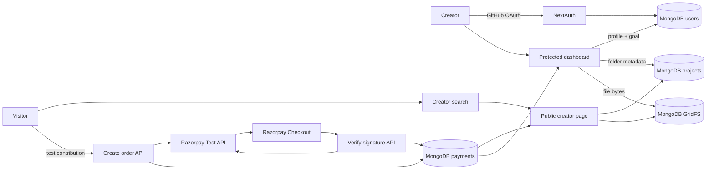

<div align="center">

# 💸 GetFunds

**A full-stack crowdfunding platform for creators — built with Next.js 15, MongoDB, and Razorpay Test Mode.**

Creators sign in with GitHub, set a funding goal, showcase project files, and receive verified test contributions from supporters, with real-time analytics on their dashboard.


[Features](#-features) •
[Tech Stack](#-tech-stack) •
[Architecture](#-architecture) •
[Getting Started](#-getting-started) •
[Security](#-security-highlights) •
[Documentation](#-documentation)

</div>

---

> [!NOTE]
> **No real money moves through this app.** GetFunds uses Razorpay's official Checkout in **Test Mode** only. The server rejects any API key that does not start with `rzp_test_`.

## 📖 Overview

GetFunds is a portfolio project that recreates the core flows of a creator-support platform end to end: authentication, creator profiles, payment processing with server-side verification, file storage, discovery, and analytics.

The focus is on **production-style engineering**: server-only secrets, HMAC signature verification, idempotent payment state transitions, session-authorized mutations, and MongoDB aggregation pipelines.

## ✨ Features

### For creators
- 🔐 **GitHub OAuth sign-in** with collision-safe username provisioning
- 🎯 **Editable funding goals** with live progress bars and "goal reached" states
- 📁 **Project folders** backed by MongoDB GridFS (upload, stream, delete)
- 📊 **Analytics dashboard**: total raised, contribution count, unique supporters, average contribution, and a 30-day trend chart
- 📤 **CSV export** of verified contributions, protected against spreadsheet formula injection
- 📝 **Bio and website** on public pages, also used for Open Graph metadata

### For supporters
- 🔎 **Creator search** with debounced prefix matching and similar-name suggestions
- 🌍 **Explore page** listing top-funded and newest creators (ISR, revalidated every 60s)
- 💳 **Razorpay Test Checkout** with mock UPI, card, wallet, and netbanking flows
- 🏆 **Top and Recent supporter** tabs on every creator page
- 🔗 **Share button** using the native share sheet, with a clipboard fallback

## 🛠 Tech Stack

| Layer | Technology |
|---|---|
| **Framework** | Next.js 15 (App Router, Server Actions, ISR), React 19 |
| **Styling** | Tailwind CSS 4 |
| **Auth** | NextAuth.js (GitHub OAuth provider) |
| **Database** | MongoDB with Mongoose ODM |
| **File storage** | MongoDB GridFS (`projectFiles` bucket) |
| **Payments** | Razorpay Standard Checkout (Test Mode) |
| **Testing** | Node.js built-in test runner |
| **Tooling** | ESLint 9, Turbopack |

## 🏗 Architecture



### Payment lifecycle

1. The supporter enters a name, message, and amount on a creator's page.
2. `POST /api/razorpay/order` validates the input, creates a Razorpay order on the server, and stores a **pending** payment record.
3. Razorpay Test Checkout opens. The supporter picks a mock success or failure.
4. `POST /api/razorpay/verify` checks the **HMAC-SHA256 signature**, then fetches the payment from Razorpay to confirm amount, currency, order ID, and status.
5. The record moves from `done:false` to `done:true` in one atomic update. Only verified payments count toward analytics.

More diagrams (sequence flows, state machine, data model) are in [`my-app/docs`](./my-app/docs).

## 📂 Project Structure

```text
GetFunds/
├── my-app/
│   ├── app/
│   │   ├── [username]/          # Public creator pages
│   │   ├── api/
│   │   │   ├── auth/            # NextAuth route
│   │   │   ├── razorpay/        # Order creation + verification
│   │   │   ├── projects/        # Project folders + GridFS file delivery
│   │   │   └── contributions/   # CSV export
│   │   ├── dashboard/           # Protected creator dashboard
│   │   ├── explore/             # Leaderboard (ISR)
│   │   └── login/
│   ├── actions/                 # Server actions
│   ├── components/              # UI components
│   ├── lib/                     # Auth, validation, GridFS, formatting helpers
│   ├── models/                  # Mongoose schemas: User, Payment, Project
│   ├── db/                      # MongoDB connection
│   ├── tests/                   # Unit tests
│   └── docs/                    # Architecture docs + diagrams
└── GETFUNDS_COMPLETE_PROJECT_GUIDE.md
```

## 🚀 Getting Started

### Prerequisites

- **Node.js 20** (an `.nvmrc` is included)
- **MongoDB**, either local or [MongoDB Atlas](https://www.mongodb.com/atlas)
- A **GitHub OAuth App**
- A **Razorpay account** in Test Mode

### 1. Clone and install

```bash
git clone https://github.com/DIVANSINGH-17/GetFunds.git
cd GetFunds/my-app
nvm use
npm install
```

### 2. Configure environment variables

```bash
cp .env.example .env.local
```

| Variable | Description |
|---|---|
| `NEXTAUTH_URL` | App URL, e.g. `http://localhost:3000` |
| `NEXTAUTH_SECRET` | A strong random secret (`openssl rand -base64 32`) |
| `GITHUB_ID` / `GITHUB_SECRET` | GitHub OAuth App credentials |
| `MONGO_URI` | MongoDB connection string |
| `RAZORPAY_KEY_ID` | Razorpay **test** key ID (must start with `rzp_test_`) |
| `RAZORPAY_KEY_SECRET` | Razorpay test secret. Never prefix it with `NEXT_PUBLIC_` |

### 3. Create a GitHub OAuth App

In **GitHub → Settings → Developer settings → OAuth Apps**, set:

```text
Homepage URL:  http://localhost:3000
Callback URL:  http://localhost:3000/api/auth/callback/github
```

### 4. Run the app

```bash
npm run dev -- --turbopack
```

Then open **http://localhost:3000**.

### 🧪 Making a test payment

1. Search for or open a creator's page.
2. Enter a name, message, and amount, then open Checkout.
3. In the UPI flow, enter:
   - `success@razorpay` to simulate a successful payment
   - `failure@razorpay` to simulate a failed payment
4. The contribution appears only after the server has verified it.

## 📜 Available Scripts

Run these from the `my-app` directory.

| Command | Description |
|---|---|
| `npm run dev` | Start the development server |
| `npm run build` | Create a production build |
| `npm run start` | Serve the production build |
| `npm run lint` | Run ESLint |
| `npm test` | Run unit tests |

## 🔒 Security Highlights

- **Server-only secrets:** `RAZORPAY_KEY_SECRET` never reaches the browser.
- **Signature verification:** HMAC-SHA256 with `crypto.timingSafeEqual`.
- **Remote confirmation:** amount, currency, order ID, and status are re-checked against Razorpay's API.
- **Idempotent completion:** only a `done:false` record can become completed, so a payment can't be counted twice.
- **Auto-cleanup:** unfinished orders expire after 24 hours through a MongoDB TTL index.
- **Session-derived ownership:** profile updates ignore identity fields sent by the browser and only write allow-listed fields.
- **Safe search:** regex metacharacters are escaped before queries run.
- **Safe file delivery:** potentially executable types such as HTML are forced to download instead of rendering.
- **Upload limits:** up to 5 files per folder, 5 MB per file, and 15 MB per folder.
- **CSV injection protection:** exported cells are sanitized against spreadsheet formulas.

## 📚 Documentation

| Document | Description |
|---|---|
| [Application setup](./my-app/README.md) | Detailed setup and feature notes |
| [Current architecture](./my-app/docs/05-current-demo-architecture.md) | System design and payment lifecycle |
| [Diagrams](./my-app/docs) | System, sequence, and data architecture diagrams |
| [Complete project guide](./GETFUNDS_COMPLETE_PROJECT_GUIDE.md) | In-depth walkthrough of the codebase |

## 🗺 Roadmap

- [ ] Deploy a public demo
- [ ] Add screenshots and a demo GIF to this README
- [ ] Razorpay webhooks for asynchronous payment reconciliation
- [ ] Broader test coverage (API routes and integration tests)
- [ ] Email notifications for creators

## 👤 Author

**Divan Singh**

[](https://github.com/DIVANSINGH-17)

---

<div align="center">

If you found this project useful, consider giving it a ⭐

</div>
