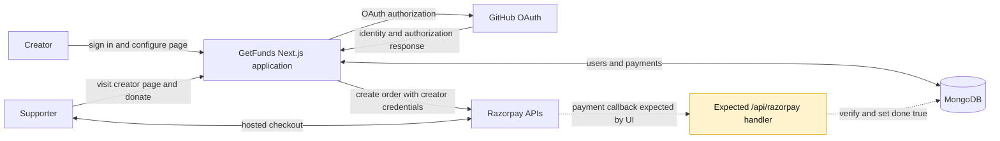

# High-level system diagram

> **Historical architecture:** this document describes the original Razorpay prototype. The current no-real-money implementation is documented in [05-current-demo-architecture.md](./05-current-demo-architecture.md).

## Diagram



The solid arrows show behavior represented in the repository. The dashed arrows show the intended payment-completion path whose callback route is currently missing.

## What is inside the system boundary?

GetFunds is a monolithic full-stack Next.js application. The same deployable application contains:

- public pages and React client components;
- server-rendered route logic;
- NextAuth.js authentication endpoints and session callbacks;
- server actions for creator and payment operations;
- Mongoose models and MongoDB access; and
- server-side Razorpay order creation.

This is a useful architecture for a small product because the UI and backend share one repository, deployment, language, and domain model. It is not a pure browser-only app: secrets and database operations run on the server side.

## Actors

### Creator

A creator signs in with GitHub, receives a GetFunds user record, and edits a profile in the dashboard. The profile stores a username, public images, and Razorpay credentials. The username becomes the public route, for example `/alice`.

### Supporter

A supporter does not need to authenticate in the current implementation. They open a creator's public page, see the ten largest completed contributions, enter a name/message/amount, and launch Razorpay Checkout.

## External systems

### GitHub OAuth

GitHub proves the creator's identity. NextAuth.js handles the OAuth endpoints, provider redirects, and session cookie/JWT mechanics. On a successful sign-in, the application tries to find or create a local MongoDB `User` record.

### MongoDB

MongoDB is the system of record for:

- creator identity and page configuration in the `users` collection; and
- contribution/order state in the `payments` collection.

Mongoose supplies schemas and query methods. The application connects using `MONGO_URI`.

### Razorpay

Razorpay creates and processes INR payment orders. The server action uses the target creator's Razorpay key ID and secret to create the order; the browser then opens Razorpay Checkout using the returned order ID.

## Core business capability

Conceptually, the application maps many creators to many fundraising pages:

```text
one User record -> one username -> one public fundraising page -> many Payment records
```

This lets several creators receive contributions independently. It does **not** currently model multiple named campaigns, goals, deadlines, or rewards for one creator. If an interviewer asks about “concurrent campaigns,” explain that the current version supports concurrent creator fundraising pages; a dedicated `Campaign` entity would be the next step for multiple campaigns per creator.

## High-level request paths

| Capability | Entry point | Server-side work | Stored result |
|---|---|---|---|
| GitHub login | `/login` | NextAuth exchanges OAuth data and runs callbacks | A `User` may be created; a session is issued |
| Profile setup | `/dashboard` | `fetchuser` and `updateProfile` server actions | `User` fields are updated |
| Public page | `/{username}` | Server component checks that the user exists; client fetches user/payments | No write |
| Start donation | Pay button | `initiate` creates a Razorpay order and pending `Payment` | `Payment.done` starts as `false` |
| Complete donation | Razorpay callback | Expected: verify signature and update the matching order | Not implemented in this repository |

## Trust boundaries

Three boundaries matter in an interview:

1. **Browser to Next.js server**: browser input is untrusted and must be validated and authorized.
2. **Next.js to MongoDB**: only server code should hold `MONGO_URI` and perform database writes.
3. **Next.js/Razorpay boundary**: order creation and payment verification require server-held secrets and cryptographic signature verification.

The current project correctly creates Razorpay orders on the server, but `fetchuser` also serializes the full user record—including `razorpaysecret`—to public client code. This must be removed in a production version by returning a safe public projection and keeping secrets server-only.

## Source-code map

| Area | Primary file |
|---|---|
| Root layout and global providers | `app/layout.js` |
| Dynamic creator route and metadata | `app/[username]/page.js` |
| Public contribution UI | `components/PaymentPage.js` |
| Creator settings UI | `components/Dashboard.js` |
| Authentication | `app/api/auth/[...nextauth]/route.js` |
| Server actions | `actions/useractions.js` |
| MongoDB connection | `db/connectDB.js` |
| User model | `models/User.js` |
| Payment model | `models/Payment.js` |
