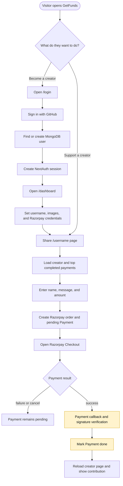
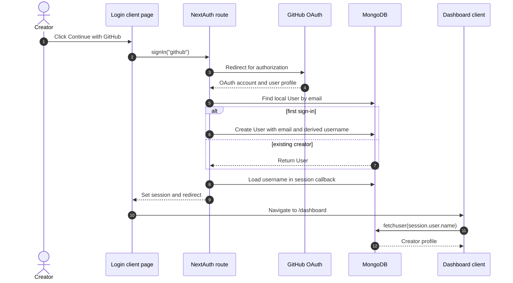
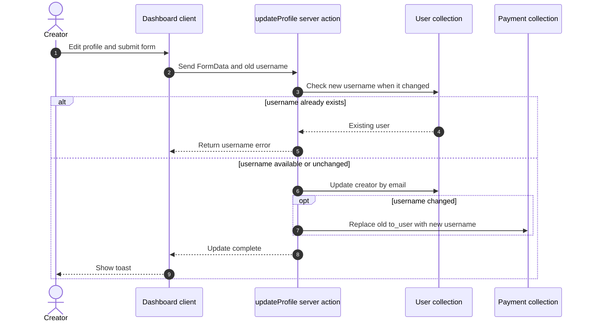
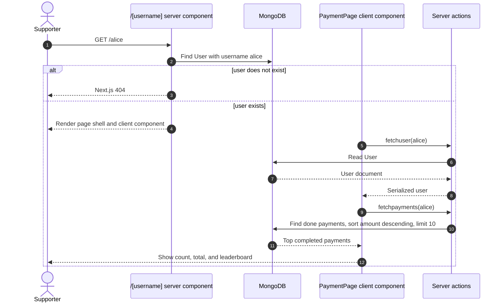
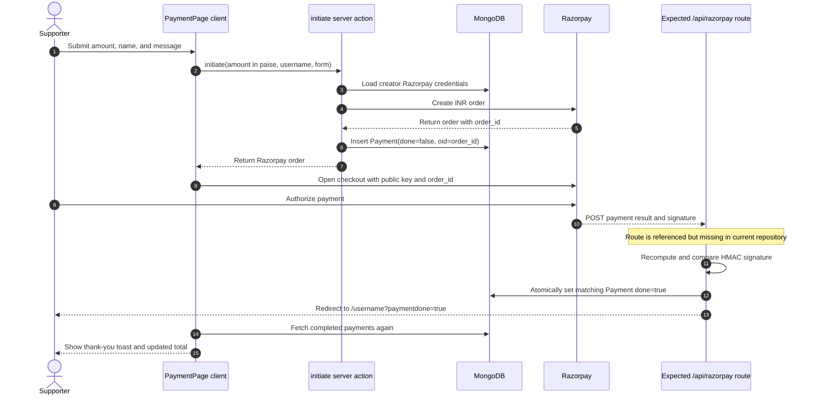
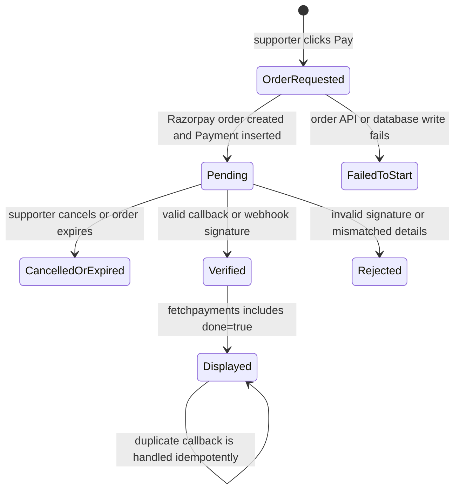

# GetFunds workflow diagrams

> **Historical architecture:** this document describes the original Razorpay prototype. The current no-real-money implementation is documented in [05-current-demo-architecture.md](./05-current-demo-architecture.md).

This document describes the application as a set of user and request workflows. It separates behavior that exists now from payment completion behavior that the UI expects but the repository does not yet implement.

## 1. End-to-end user journey



`Callback` and `Completed` are highlighted because the configured `/api/razorpay` callback is absent. Until it exists, newly created records remain pending and are excluded by `fetchpayments`.

## 2. Authentication and creator onboarding



### Why both GitHub and MongoDB are needed

GitHub authenticates the person but does not contain GetFunds-specific fields such as the cover image, public username, or Razorpay configuration. The local `User` record connects the external identity (`email`) to application-owned data.

### Session behavior

No NextAuth database adapter or explicit session strategy is configured, so NextAuth v4 uses its default JWT-based session strategy for an OAuth-only configuration. The `session` callback replaces `session.user.name` with the database username; components then use that value to build the public URL and fetch the creator profile.

### Current implementation cautions

- The sign-in callback queries `User.findOne({ email: email })`, but for the GitHub provider it should use `user.email`; the callback's `email` argument is associated with the Email provider flow.
- The session callback performs a database query without explicitly calling `connectDb()`.
- Username creation uses the email prefix, so collisions are possible and should be handled.
- The dashboard redirects inside an effect whose dependency list is empty; it should account for NextAuth's loading state.

## 3. Creator profile update



Updating related payment records preserves the creator's contribution history when the public URL changes. In production, both updates should be performed in a MongoDB transaction where supported, and the server action should derive the authenticated email/username from the server session rather than trusting fields sent by the browser.

The UI currently always displays “Profile Updated” and does not inspect the returned `{ error }` value. That should be corrected before presenting username-conflict handling as complete.

## 4. Public creator-page read workflow



The dynamic route itself runs on the server and can return a server-side 404. `generateMetadata` also produces a per-creator title on the server. However, the profile and payment data displayed by `PaymentPage` is fetched after hydration in `useEffect`, so the main funding data is client-loaded rather than fully server-rendered HTML.

The label “real-time” should therefore be interpreted as dynamically calculated from current database results when the page loads. There is no WebSocket, Server-Sent Events, polling interval, or MongoDB change stream that pushes live updates to an already open browser.

## 5. Payment initiation and intended completion



### Amount handling

Razorpay expects the smallest currency unit. The browser multiplies a rupee value by `100`, and `initiate` sends that paise amount to Razorpay. The stored `Payment.amount` divides it by `100`, so MongoDB stores the display value in rupees.

Example:

```text
supporter enters ₹50 -> browser sends 5000 paise -> Razorpay order is 5000 -> MongoDB stores 50
```

For financial software, storing an integer number of paise is safer than storing rupees because integer arithmetic avoids rounding ambiguity.

### Why create a pending record first?

The pending row connects the locally known donation details to Razorpay's order ID. The callback can later locate that exact row using `oid` and mark it complete only after verification. Reads deliberately use `{ done: true }`, preventing unverified orders from appearing as money raised.

### Production-safe completion rules

A complete callback/webhook should:

1. parse the Razorpay order ID, payment ID, and signature;
2. load the pending payment and the correct creator credentials;
3. verify the HMAC signature with the server-side secret using a timing-safe comparison;
4. confirm the amount, currency, order ID, and captured/authorized state;
5. update by unique order/payment ID using an idempotent operation;
6. never trust a `paymentdone=true` query parameter as proof of payment; and
7. log failures without logging secrets or sensitive payment data.

## 6. Payment state machine



The current schema has only a Boolean `done`, so `CancelledOrExpired`, `Rejected`, and error reasons are conceptual states. A production schema would normally use a status enum such as `created`, `authorized`, `captured`, `failed`, and `refunded`, plus provider payment IDs and timestamps.
