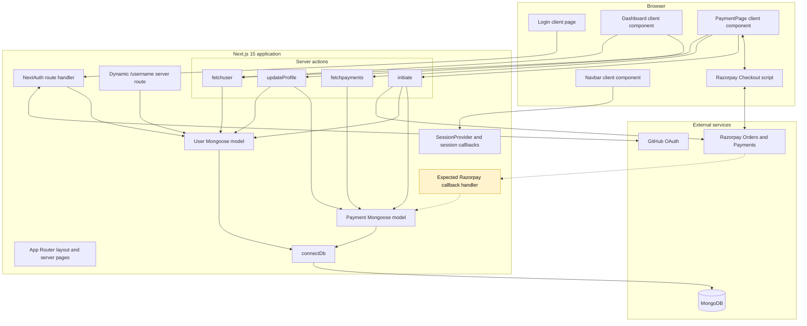
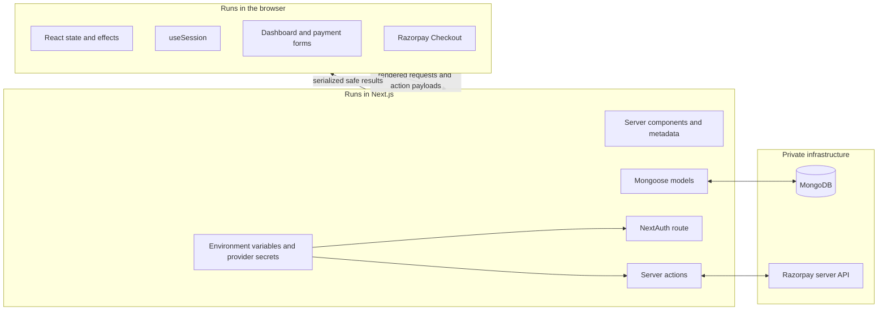
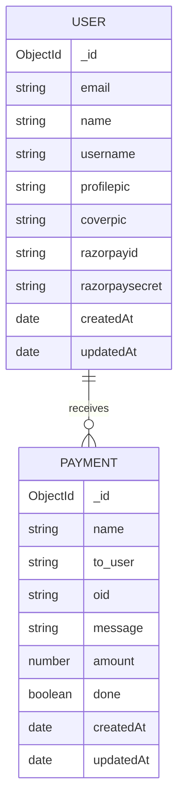

# GetFunds architecture diagram

> **Historical architecture:** this document describes the original Razorpay prototype. The current no-real-money implementation is documented in [05-current-demo-architecture.md](./05-current-demo-architecture.md).

## Component architecture



## Architectural style

The application uses a **full-stack modular monolith**:

- **full-stack**, because React UI and server/database/payment logic live in one Next.js application;
- **modular**, because components, server actions, models, database connection code, and route handlers are separated by responsibility; and
- **monolith**, because these modules are built and deployed as one unit rather than as independent services.

This architecture avoids the operational cost of microservices while the product is small. The main risk is that access-control and data-serialization boundaries can become unclear, so server actions must be treated as public server entry points and secured accordingly.

## Layer-by-layer explanation

### 1. Presentation layer

The App Router supplies pages and layouts. `app/layout.js` wraps every page with `SessionProvider`, `Navbar`, and `Footer`. Components marked `"use client"` handle state, effects, clicks, navigation, toasts, and Razorpay Checkout.

| UI module | Responsibility | Rendering behavior |
|---|---|---|
| `app/page.js` | Landing page | Server component by default |
| `app/about/page.js` | Product information | Server component by default |
| `app/[username]/page.js` | Validate username and provide dynamic metadata | Server component |
| `components/PaymentPage.js` | Contribution form, totals, and leaderboard | Client component |
| `components/Dashboard.js` | Creator profile/settings form | Client component |
| `app/login/page.js` | Starts GitHub OAuth | Client component |
| `components/Navbar.js` | Session-aware navigation | Client component |

### 2. Application/service layer

`actions/useractions.js` is the application boundary for domain operations:

- `fetchuser(username)` loads a creator;
- `fetchpayments(username)` loads up to ten completed payments, ordered by amount;
- `updateProfile(data, oldusername)` updates a creator and migrates payment ownership when the username changes; and
- `initiate(amount, to_username, paymentform)` creates a Razorpay order and a pending local payment.

Because this file starts with `"use server"`, Next.js exposes exported actions to client components through generated RPC-style calls. This keeps SDK secrets and Mongoose code out of the browser bundle, but it does not automatically provide authorization or validation. Each action must still verify the session, validate data, and return only safe fields.

### 3. Authentication layer

`app/api/auth/[...nextauth]/route.js` configures GitHubProvider and exports the NextAuth handler for both GET and POST. The sign-in callback provisions a local user; the session callback adds the local username to `session.user.name`.

The route name is a catch-all dynamic API route, so it handles endpoints such as sign-in, callback, sign-out, session lookup, and CSRF operations under `/api/auth/*`.

### 4. Persistence layer

`db/connectDB.js` opens the Mongoose connection from `MONGO_URI`. Model files use the common hot-reload-safe pattern:

```js
mongoose.models.User || model("User", UserSchema)
```

That prevents model recompilation errors during Next.js development reloads.

### 5. Payment integration layer

Razorpay has two halves:

- the server SDK creates an order with secret credentials; and
- the checkout script collects payment details in Razorpay's UI.

The browser should receive only the public key ID, order ID, amount, and display configuration. The key secret must remain server-side. Payment success must be verified on the server; a browser redirect alone is not trustworthy.

## Client/server execution boundary



The phrase “serialized safe results” describes the required boundary. Currently `fetchuser` returns the complete `User` object, including the Razorpay secret, which violates that boundary. A public query should explicitly select only fields such as `username`, `name`, `profilepic`, `coverpic`, and `razorpayid`.

## Data architecture



The relationship is implemented through `Payment.to_user -> User.username`, not an ObjectId reference. This makes page queries readable but creates extra work when a username changes: `updateProfile` must rewrite all associated payments.

A production model would normally:

- make `User.email` and `User.username` unique and indexed;
- store an immutable `creatorId` ObjectId in `Payment`;
- make `Payment.oid` unique for idempotency;
- store money as integer paise;
- replace `done` with a payment-status enum;
- encrypt provider credentials at rest or use a connected-account/token model; and
- optionally introduce `Campaign`, allowing one creator to own multiple campaigns.

An expanded relationship would be:

```text
User 1 --- many Campaigns 1 --- many Payments
```

## Rendering architecture and SSR claim

Next.js uses a mix of server and client rendering in this repository:

- `/`, `/about`, `/dashboard`'s route wrapper, and `/[username]` are server components by default;
- `/[username]` queries MongoDB before returning and can emit a server-generated 404;
- `generateMetadata` creates a dynamic title on the server;
- `PaymentPage`, `Dashboard`, `Login`, and `Navbar` are client components; and
- creator details and payment totals are fetched from the client after mount.

Therefore, it is accurate to say the application **uses Next.js server components and server-generated metadata**, helping routing and page-specific SEO. It is too strong to say the complete funding page is SSR, because the primary profile/payment content is not included in the initial server-rendered HTML. Moving those reads into `app/[username]/page.js` and passing safe data as props would make the claim stronger and improve first-content rendering.

## Environment and secret ownership

| Variable | Used for | Correct visibility |
|---|---|---|
| `MONGO_URI` | MongoDB connection | Server only |
| `GITHUB_ID` | GitHub OAuth app identity | Server configuration |
| `GITHUB_SECRET` | GitHub OAuth secret | Server only |
| `NEXTAUTH_SECRET` | Signs/encrypts NextAuth values | Server only |
| `NEXTAUTH_URL` | OAuth callback base URL | Server configuration |
| `NEXT_PUBLIC_URL` | Razorpay callback URL base | Public by naming convention |

Creator Razorpay secrets are stored in MongoDB rather than environment variables because each creator supplies separate credentials. They must still remain server-only and should be encrypted at rest.

## Current non-functional characteristics

### Scalability

Stateless Next.js instances can scale horizontally if sessions remain JWT-based and MongoDB/Razorpay are external. Database connection reuse, indexes, pagination, rate limiting, and caching would become important under load.

### Consistency

Payment initiation spans two systems: Razorpay order creation and MongoDB insertion. If one succeeds and the other fails, reconciliation is needed. Webhooks and an idempotent status update are the standard recovery mechanism.

### Security

The strongest current boundary is server-side Razorpay order creation. The largest gaps are public serialization of creator secrets, missing callback verification, missing server-action authorization, and overly broad profile updates from raw form data.

### Observability

The repository logs MongoDB connection state but has no structured payment/audit logging, metrics, tracing, or alerting. Production payment flows should attach a request/correlation ID and record state transitions without secrets.

## Current architecture versus production target

| Concern | Current repository | Production target |
|---|---|---|
| Campaign model | One public page per username | Separate Campaign entity with goals/status |
| Payment completion | Callback URL referenced, handler absent | Verified callback plus webhook reconciliation |
| Dashboard | Creator profile configuration | Funding KPIs, history, filters, polling or push updates |
| Public data | Full user object returned | Allow-listed public projection |
| Authorization | Mostly client-side redirect | Session checks inside every protected server action |
| SSR | Route validation and metadata on server | Creator/payment content fetched in server component |
| Data integrity | Mutable username relationship | Immutable IDs, unique indexes, transaction/idempotency |
