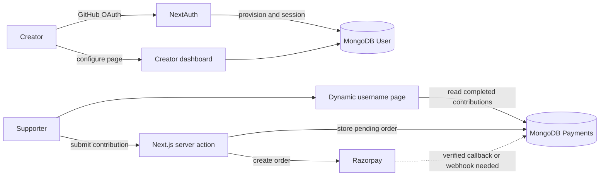
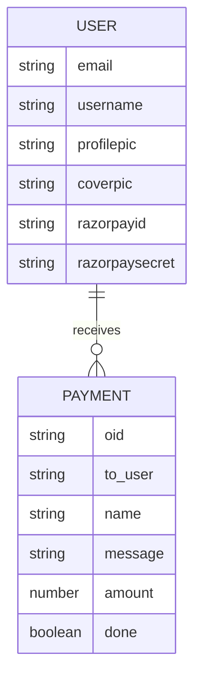
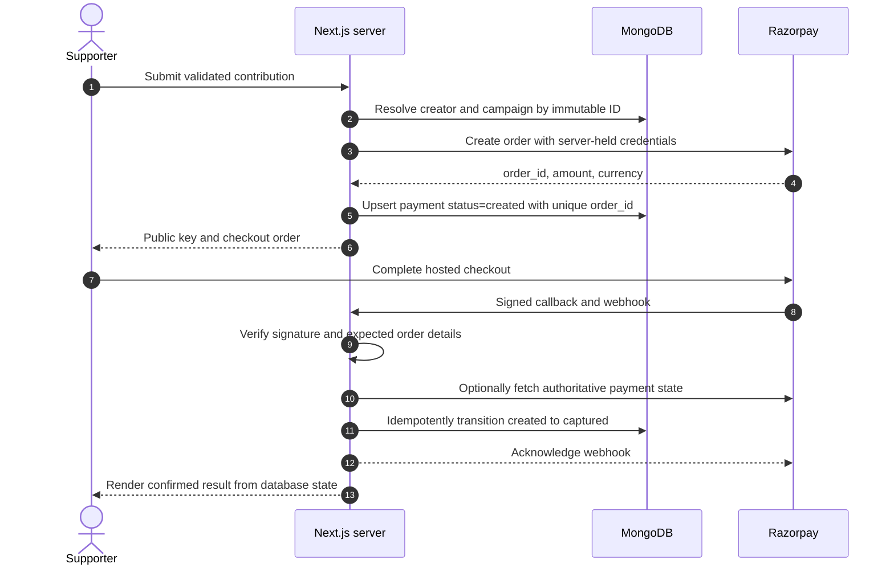

# GetFunds resume and interview guide

> **Historical interview guide:** this document maps the original Razorpay prototype. Use [05-current-demo-architecture.md](./05-current-demo-architecture.md) for defensible claims about the current implementation.

## One-sentence description

GetFunds is a full-stack Next.js crowdfunding application where creators authenticate with GitHub, configure a username-based fundraising page, and accept INR contributions through Razorpay while MongoDB stores creator profiles and payment state.

## 60-second interview pitch

> I built GetFunds as a full-stack crowdfunding platform using the Next.js App Router. A creator signs in through GitHub OAuth using NextAuth, and on first login the application provisions a local MongoDB user. The creator configures a public username-based fundraising page and their Razorpay account. A supporter can visit that page without logging in, submit a contribution, and the server creates a Razorpay order while recording a pending payment in MongoDB. The public page queries completed payments to calculate the raised amount and show the top ten supporters. I used server components for route validation and dynamic metadata, client components for interactive forms and checkout, and server actions for database and Razorpay operations. The project also taught me that payment verification, idempotency, strict server-side authorization, and secret handling are essential before production deployment.

That pitch describes the actual code and proactively shows good engineering judgment about its current limits.

## System flow to draw in an interview

When drawing it, explain the solid path first. Then mention that the dashed arrow is the critical completion path and that the current repository still needs the callback handler.

## Resume claims mapped to evidence

### Header

> GetFunds | Next.js, MongoDB, Razorpay, NextAuth.js

This technology list is supported by `package.json` and the implementation:

- Next.js 15 App Router provides routes, server components, route handlers, and server actions.
- MongoDB is accessed through Mongoose and stores `User` and `Payment` documents.
- Razorpay's server SDK creates INR orders, and its checkout script opens the hosted payment UI.
- NextAuth.js handles GitHub OAuth and sessions.

### Resume bullet 1

> Developed a full-stack crowdfunding platform using Next.js and MongoDB, enabling developers to create and manage concurrent fundraising campaigns.

#### What the code actually does

- The frontend, backend operations, authentication endpoint, and database layer are in one Next.js application.
- `User` stores the creator profile and payment configuration.
- `Payment` stores contributions for a creator using `to_user`.
- The dynamic route `/{username}` provides one public fundraising page for every creator.
- `Dashboard` lets a creator manage page/profile settings.
- Many creators can have active pages and receive independent payment orders at the same time.

#### What “concurrent campaigns” means here

The current version treats a creator's public page as the campaign. It supports many creators' pages concurrently, but it does not have a `Campaign` model and cannot create multiple separately named campaigns for one creator.

If questioned, say:

> In the first version, I modeled a campaign implicitly as a creator's username page. That allowed multiple creators to fundraise concurrently with a simple one-to-many User-to-Payment design. For multiple campaigns per creator, I would add a Campaign collection and make payments reference an immutable campaign ID.

#### Stronger, precise resume wording

> Built a full-stack crowdfunding platform with Next.js and MongoDB, enabling multiple creators to configure and operate independent username-based fundraising pages.

Use the original sentence only if you later implement an explicit `Campaign` entity.

### Resume bullet 2

> Integrated Razorpay for secure financial transactions and built a dynamic dashboard for real-time funding tracking.

#### Razorpay flow implemented in the code

1. The browser converts rupees to paise and calls `initiate`.
2. The server loads the target creator's Razorpay credentials.
3. The Razorpay server SDK creates an INR order.
4. MongoDB receives a `Payment` record with the order ID and `done: false`.
5. The server returns the order to the browser.
6. The Razorpay checkout script opens using the public key ID and order ID.
7. `fetchpayments` displays only records where `done: true`.

This pending-then-verified design is the correct shape: unverified orders should never count toward funds raised.

#### What is not yet implemented

`PaymentPage` points Razorpay to `/api/razorpay`, but that route does not exist in the repository. There is therefore no code that verifies the Razorpay signature and changes `done` to `true`. The browser query parameter `paymentdone=true` only shows a toast and must never be treated as payment proof.

Also, the current dashboard is a profile/settings dashboard. Funding totals are calculated on the public creator page when its client component loads. The data is dynamic, but it is not live real-time data: there are no WebSockets, Server-Sent Events, change streams, or polling.

#### How to explain secure payment processing

Say that secure processing requires all of the following:

- create orders server-side so the secret is not in browser code;
- use the provider-hosted checkout so card details do not pass through GetFunds;
- store an internal pending record linked by provider order ID;
- verify the callback/webhook HMAC signature on the server;
- compare expected amount, currency, and order identity;
- make completion idempotent so retries do not double-count a payment; and
- expose only completed payments in funding totals.

The project currently implements order creation, hosted checkout, pending persistence, and completed-only reads. Be clear that callback verification is the required next piece.

#### Stronger, precise resume wording for the current code

> Integrated Razorpay order creation and hosted checkout, persisted pending payment records in MongoDB, and built a dynamic creator page that aggregates completed funding and ranks the top ten supporters.

After implementing callback verification and a live dashboard, you can safely restore the stronger “secure transactions” and “real-time tracking” language.

### Resume bullet 3

> Implemented NextAuth.js for secure OAuth login and leveraged Server-Side Rendering (SSR) to optimize SEO and performance.

#### OAuth flow implemented in the code

1. `signIn("github")` starts authentication from the login page.
2. NextAuth redirects the visitor to GitHub.
3. GitHub returns identity/account data to the catch-all NextAuth route.
4. The sign-in callback connects to MongoDB and tries to find or create the local user.
5. The session callback loads the local username and exposes it as `session.user.name`.
6. `SessionProvider` makes session state available to client components.
7. The navbar changes its actions, and the dashboard redirects unauthenticated visitors.

OAuth is preferable to storing passwords in this project because GitHub handles credential verification and GetFunds receives an identity after authorization. NextAuth also handles state/CSRF protections and session mechanics.

#### SSR behavior implemented in the code

- `app/[username]/page.js` is a server component.
- It queries MongoDB before returning and calls `notFound()` for an invalid username.
- `generateMetadata` builds a server-side title such as `Support alice - Get Me A Chai`.
- The landing and about pages are server components by default.

However, the visible creator record, payments, total, and leaderboard are fetched in `PaymentPage` after the client mounts. This means the most important creator content is client-rendered, not fully SSR.

#### Why server rendering helps

- Search engines and link previews can receive route-specific metadata.
- The server can reject an invalid creator route before sending a successful page.
- Server-rendered content can reduce the time to meaningful first paint and the amount of client JavaScript when data fetching stays in server components.
- Server-only code can access the database without exposing database credentials.

#### Stronger, precise resume wording

> Implemented GitHub OAuth and session-aware navigation with NextAuth.js, and used Next.js server components plus dynamic metadata for server-side route validation and page-specific SEO.

If you move `fetchuser` and `fetchpayments` into the server route and pass safe data into `PaymentPage`, then the broader SSR claim will be much more defensible.

## Deep technical explanation by feature

### Why use server actions?

Server actions let client components call server-side operations without creating a separate REST endpoint for every form. They are useful here for profile updates, database reads, and Razorpay order creation. They are still network-accessible server entry points, so the application must validate input, verify the session for protected actions, and authorize the affected record.

### Why maintain a local user after OAuth?

The OAuth provider owns identity data, while GetFunds owns application data. A local user gives the project a stable place for the public username, page images, Razorpay configuration, and future campaign ownership. Email is currently the link, though a production model should store the provider name and provider account ID because emails can change.

### Why keep `done: false` first?

Creating an order does not mean money was paid. The pending state separates “checkout started” from “provider verified payment.” Only after a signed server callback/webhook should the record become completed and appear in totals.

### Why sort and limit payments?

`fetchpayments` sorts by amount descending and limits the result to ten. This implements the supporter leaderboard and prevents the initial page from returning an unbounded payment history. A full history would use pagination and a separate aggregate query for total amount/count.

### How are totals calculated?

The client receives up to ten completed payments and uses `reduce` to sum their amounts. This means the displayed total is actually the total of the top ten returned payments, not necessarily all completed contributions. For a correct overall total, MongoDB should use an aggregation pipeline such as `$match` plus `$group`, while the leaderboard remains a separate sorted/limited query.

### What happens when a username changes?

`updateProfile` checks for a collision, updates the user, and rewrites `Payment.to_user` from the old username to the new one. This keeps the contribution list connected to the new page. An immutable `creatorId` foreign key would avoid the bulk rewrite and reduce consistency risk.

### How does the app support many users at once?

Requests do not store creator state in a server process; creator identity comes from the route/session and durable data lives in MongoDB. That makes individual Next.js instances largely stateless and horizontally scalable. MongoDB handles simultaneous document operations, while each Razorpay order has a unique provider order ID. For robust concurrency, the schema still needs unique indexes and idempotent conditional updates.

## Data model explanation

Explain it as a one-to-many relationship: one creator can receive many payments. `oid` connects a local payment to a Razorpay order, `to_user` selects the recipient, and `done` prevents a created-but-unpaid order from entering the completed totals.

## Questions an interviewer is likely to ask

### “Why Next.js instead of separate React and Express apps?”

Next.js provided routing, server components, API route handlers, and server actions in one codebase. For this scope, that reduced deployment and integration overhead while still keeping browser code separate from database/payment-secret operations.

### “Why MongoDB?”

The creator and payment documents are straightforward to model with Mongoose, and MongoDB fits an early product whose profile fields may evolve. Payment integrity still benefits from relational-style practices: unique indexes, immutable references, transactions where needed, and explicit state transitions.

### “How do you know a payment succeeded?”

The authoritative proof must be a valid Razorpay signature received by a server endpoint or webhook, followed by provider-state validation. A frontend success message or redirect query parameter is not proof. In the current repository the handler is the main missing payment piece.

### “How do you prevent duplicate payment processing?”

Make the Razorpay order/payment ID unique, then perform a conditional update such as “change created to captured only if it is not already captured.” Webhook retries then return success without applying the payment twice.

### “What makes the dashboard real time?”

In the current version, values are dynamic at page load but not pushed live. True real-time behavior would use polling, SSE, or WebSockets after webhook verification. Say this plainly; do not claim sockets that are not in the code.

### “Where is SSR used?”

The dynamic username route runs on the server for existence validation, and metadata is generated on the server. The interactive contribution UI is a client component and currently fetches its main data after mount. A next improvement is to load safe creator/payment data in the server component.

### “How do you protect Razorpay secrets?”

Order creation uses the secret on the server, which is the right starting point. The current `fetchuser` response accidentally includes the secret, so production hardening requires a public field projection, server-side authorization for credential changes, encrypted storage, and ideally Razorpay's connected-account/OAuth model if applicable.

### “What indexes would you add?”

- unique index on `User.email`;
- unique index on `User.username`;
- unique index on `Payment.oid`;
- compound index on `{ creatorId: 1, status: 1, amount: -1 }`; and
- possibly `{ creatorId: 1, createdAt: -1 }` for payment history.

### “What failure cases did you consider?”

- Razorpay creates an order but the MongoDB insert fails;
- a pending order is never paid;
- callbacks are delayed, duplicated, forged, or received out of order;
- the username changes while a payment is active;
- two users choose the same username concurrently;
- a client changes the amount or recipient in the request; and
- MongoDB or the payment provider is temporarily unavailable.

The remedies are validation, unique constraints, immutable IDs, idempotency, webhooks, reconciliation jobs, retries with bounded backoff, and good audit logs.

## Honest review of the current implementation

An interviewer may inspect the repository, so know these points.

| Area | Good foundation | Current limitation | Production improvement |
|---|---|---|---|
| Authentication | GitHub OAuth through NextAuth | Sign-in lookup uses the wrong callback variable; protected actions lack server auth | Use `user.email`, connect explicitly, call `getServerSession`, authorize ownership |
| Payments | Server-side order creation and pending record | Missing callback/signature verification | Add callback and webhook routes with idempotent verification |
| Secrets | Razorpay SDK runs server-side | Full `User` object sends secret to clients | Public DTO/projection, encryption at rest, credential rotation |
| Tracking | Completed-only query, total, top supporters | Only top ten are summed; no push updates | Separate aggregate totals, paginated history, polling/SSE/WebSocket |
| Campaigns | Multiple username fundraising pages | No explicit Campaign model | Add campaign ID, owner, title, goal, deadline, status |
| SSR/SEO | Server route validation and dynamic metadata | Main creator/payment content loads client-side | Fetch safe page data in server component; cache/revalidate deliberately |
| Data integrity | Collision check and payment migration | No unique schema indexes; two updates are not atomic | Unique indexes, immutable creator IDs, transaction |
| Validation | Pay button has simple UI checks | Server actions trust client data and raw update fields | Schema validation, allow-list updates, amount limits, rate limiting |

## Suggested production payment workflow

## A practical improvement roadmap

1. Add `/api/razorpay` callback and webhook verification.
2. Stop returning `razorpaysecret`; add explicit public and private user DTOs.
3. Authenticate and authorize `updateProfile` and credential reads on the server.
4. Fix the NextAuth email lookup and username-collision handling.
5. Add unique indexes and immutable creator references.
6. Separate total/count aggregation from the top-ten leaderboard.
7. Fetch public creator data in the server component for stronger SSR.
8. Add a `Campaign` model for multiple campaigns per creator.
9. Add payment history, status filters, and polling/SSE to a funding dashboard.
10. Add tests for auth, order creation, signature validation, duplicate webhooks, and username changes.

## Final resume version recommended for this repository

> **GetFunds | Next.js, MongoDB, Razorpay, NextAuth.js**  
> - Built a full-stack crowdfunding platform enabling multiple creators to configure and operate independent username-based fundraising pages backed by MongoDB.  
> - Integrated Razorpay order creation and hosted checkout, persisted pending payment state, and built a dynamic page that aggregates completed funding and ranks top supporters.  
> - Implemented GitHub OAuth and session-aware navigation with NextAuth.js, using Next.js server components and dynamic metadata for server-side route validation and page-specific SEO.

This version is technically defensible against the present code. After completing the production roadmap, the original claims about secure transaction completion, real-time dashboard tracking, full SSR, and multiple campaigns per creator can be made without qualification.
