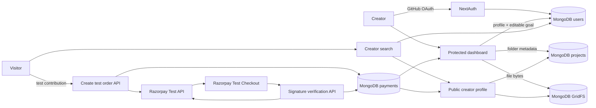
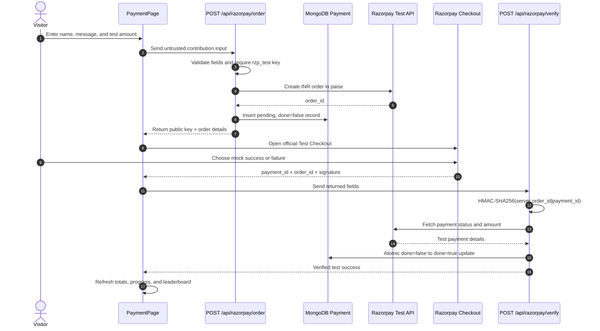
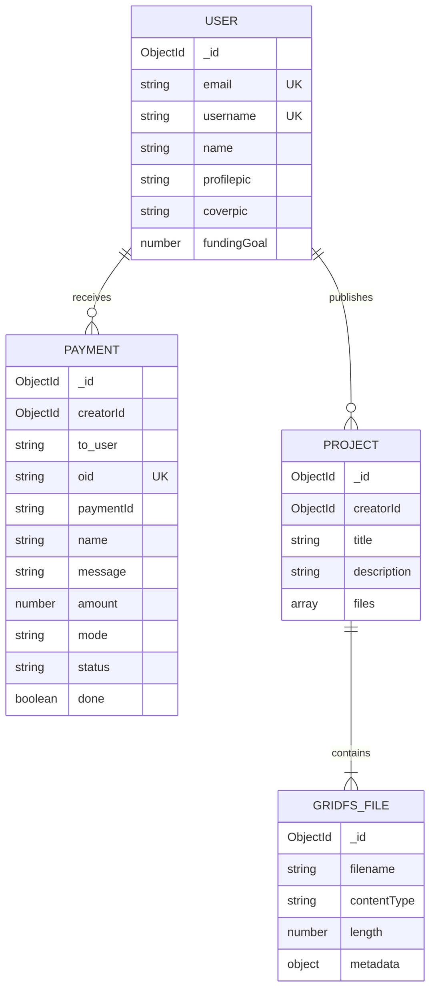

# Current GetFunds architecture

**Status:** current runtime after the Razorpay Test Mode, creator discovery, and GridFS portfolio upgrade.

GetFunds is a no-real-money portfolio application. It uses Razorpay's official Test Mode Checkout and mock bank screens, but the server explicitly rejects every key that does not begin with `rzp_test_`.

## System overview



## Razorpay Test Mode payment lifecycle



Important security decisions:

- `RAZORPAY_KEY_SECRET` never reaches the browser.
- Every contribution creates an order on the server before Checkout opens.
- The amount sent to Razorpay is derived from validated server input and converted from rupees to paise.
- Verification uses the order ID stored by the server, not an untrusted replacement.
- Signatures use HMAC-SHA256 and `timingSafeEqual`.
- The verification route also checks remote order ID, amount, currency, and payment status.
- Completion is idempotent: only a row with `done:false` can transition to completed.
- Unfinished test orders receive a 24-hour TTL; verified rows remove that expiry.
- Only `done:true` rows contribute to public analytics.
- Live Razorpay keys are rejected intentionally.

Razorpay Test Mode can display card, wallet, netbanking, and UPI mock screens. `success@razorpay` and `failure@razorpay` simulate the two UPI outcomes. No real funds are charged or settled.

## Editable creator funding target

`User.fundingGoal` is a validated number between ₹100 and ₹1,00,00,000. The creator edits it in the protected dashboard. `updateProfile` obtains ownership from the NextAuth session, ignores browser-supplied identity fields, and updates only an explicit allow-list.

The public progress calculation is:

```text
progress percentage = min(100, round(completed test funding / creator funding goal × 100))
```

₹10,000 is only the schema default for a new creator; it is no longer an immutable UI constant.

## Creator search and similar-name suggestions

The global navigation includes a debounced search box:

1. Queries shorter than two characters do not hit MongoDB.
2. Regex metacharacters are escaped before a database query is built.
3. Username/display-name prefix matches are returned first.
4. Remaining slots use substring matches as similar-name recommendations.
5. Only `_id`, display name, username, and profile image are serialized.
6. Selecting a result opens `/{username}`.

Every search result is a normal public creator page. Visitors can view project folders and start a Razorpay test contribution without signing in.

## Project folders and GridFS

A project folder is a `Project` document owned by immutable `creatorId`. It contains title, description, timestamps, and safe file metadata. Actual bytes are stored in the `projectFiles` GridFS bucket.

Why GridFS instead of `public/uploads/{username}`:

- a deployed Next.js filesystem may be read-only or ephemeral;
- username changes should not move files;
- database ownership is easier to enforce;
- large file bytes do not consume a normal MongoDB document's 16 MB limit; and
- files can be streamed instead of loading the entire stored object into the response.

Upload controls:

- creator must have an authenticated server session;
- 1-5 files per folder;
- maximum 5 MB per file;
- maximum 15 MB total per folder;
- allow-listed common code, document, text, archive, and image extensions;
- path separators/control characters are removed from filenames;
- partial GridFS uploads are deleted when an upload fails; and
- project deletion checks ownership and deletes associated GridFS objects.

Public download controls:

- the file ID must exist in a public `Project` document;
- safe images, PDF, Markdown, and plain text may render inline;
- other formats are forced to download;
- `X-Content-Type-Options: nosniff` prevents browser type guessing; and
- HTML/code files cannot execute as GetFunds application pages.

## Data model



`to_user` and `mode: "demo"` remain readable for old development rows. New Checkout records use immutable `creatorId`, `mode: "razorpay-test"`, a Razorpay order ID, and a verified payment ID.

## API and action boundaries

| Boundary | Authentication | Responsibility |
|---|---:|---|
| `searchCreators` server action | Public | Safe creator-name suggestions |
| `getPublicCreatorData` server action | Public | Safe profile, analytics, projects, and test-checkout availability |
| `getDashboardData` server action | Required | Private creator dashboard data |
| `updateProfile` server action | Required | Allow-listed profile and funding-goal mutation |
| `POST /api/razorpay/order` | Public | Validate input, create Razorpay test order, insert pending row |
| `POST /api/razorpay/verify` | Public with signed result | Verify HMAC and remote test payment, complete row idempotently |
| `POST /api/projects` | Required | Validate and upload a creator project folder |
| `DELETE /api/projects/[projectId]` | Required owner | Delete folder and its GridFS files |
| `GET /api/projects/files/[fileId]` | Public | Stream a file referenced by a public project |

## Required environment variables

```env
NEXTAUTH_URL=http://localhost:3000
NEXTAUTH_SECRET=strong-random-value
GITHUB_ID=github-oauth-client-id
GITHUB_SECRET=github-oauth-client-secret
MONGO_URI=mongodb-connection-string
RAZORPAY_KEY_ID=rzp_test_...
RAZORPAY_KEY_SECRET=test-key-secret
```

## Honest production limitations

This remains an interview project rather than a live crowdfunding platform. A production system should add persistent distributed rate limiting, abuse protection, malware scanning, object storage/CDN delivery, Razorpay webhooks for browser-drop recovery, captured-payment-only fulfillment, reconciliation jobs, privacy controls, moderation, and a deployment-specific retention policy.

## Interview pitch

> GetFunds is a full-stack crowdfunding portfolio that uses GitHub OAuth for creator identity, server-authorized profile and funding-goal mutations, global creator discovery, and public project portfolios stored with MongoDB GridFS. Visitors can open Razorpay's official Test Checkout on any creator profile. The server creates every order, stores a pending record, verifies the returned HMAC signature with a timing-safe comparison, confirms remote payment fields, and atomically completes the contribution before analytics include it. Live keys are rejected, so the project demonstrates a realistic gateway lifecycle without moving real money.
