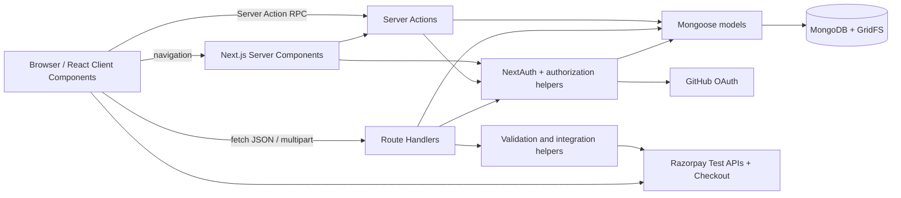
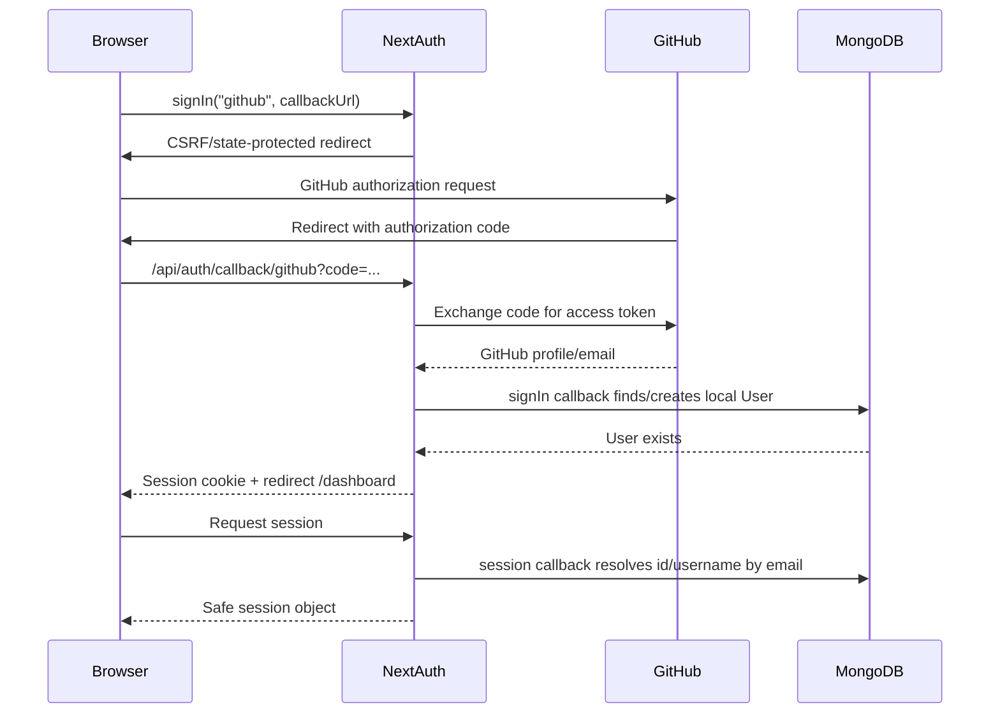
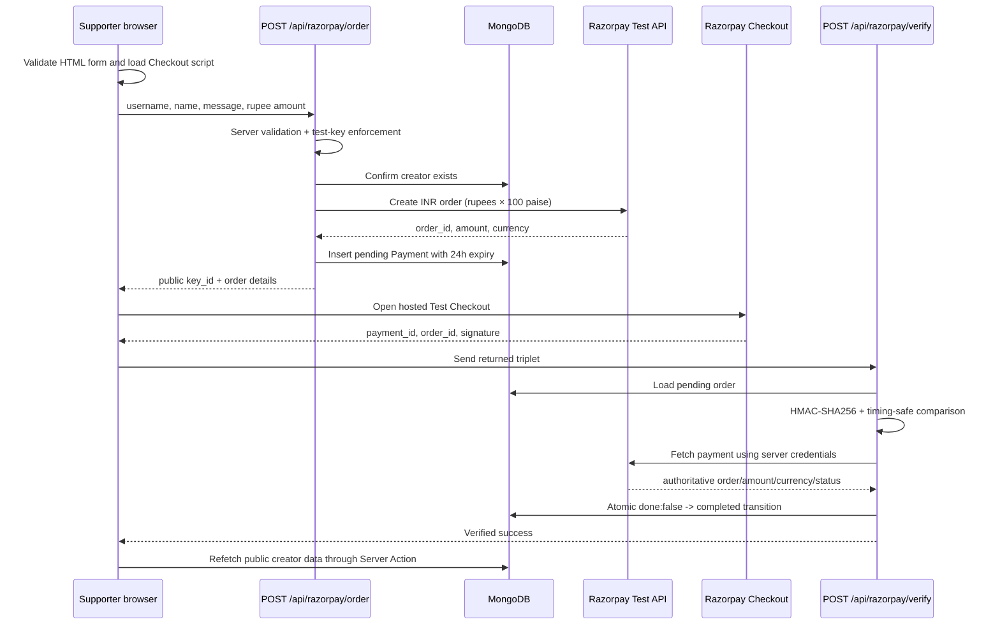

# GetFunds: In-and-Out Project Architecture Notes

> **Analysis basis:** the 4,569-line `project_codebase.txt` snapshot plus a cross-check of the live repository on 30 August 2026. Executable source code is treated as the source of truth. Some older documents inside the snapshot describe an earlier payment implementation, so this guide explicitly separates current behavior from historical or proposed behavior.

GetFunds is a **full-stack modular monolith**: one Next.js application contains the pages, browser UI, server-side application logic, HTTP API routes, authentication callbacks, database models, and third-party integrations. It is a portfolio demonstration rather than a real crowdfunding platform. Razorpay is deliberately restricted to **Test Mode**, so the real Razorpay Checkout interface appears but no real money moves.

The simplest mental model is a small office building:

- React components are the reception desks visitors interact with.
- Next.js Server Components and Route Handlers are the staff behind the desks.
- NextAuth is the security desk that checks GitHub identity.
- MongoDB is the records room.
- Mongoose is the records clerk that enforces document shape.
- GridFS is the large-file cabinet inside that records room.
- Razorpay Test Mode is an external payment simulator.
- Server Actions and API routes are secure service windows through which the browser requests work.

---

## 1. 🏛️ Global Architecture & Data Lifecycles

### 1.1 Detected technology inventory

#### Runtime and application dependencies

| Technology/package | Installed version | Exact responsibility in this repository |
|---|---:|---|
| **Node.js** | `20.18.0` from `.nvmrc` | Server runtime. Supplies native `fetch`, `Buffer`, Web Streams interoperability, `crypto`, `stream`, URL parsing, and the JavaScript execution environment used by Next.js. `package.json` permits Node `>=20 <23`. |
| **Next.js** | `15.4.6` | App Router, file-system routing, Server and Client Components, Route Handlers, Server Actions, metadata, image/link/navigation components, redirects, 404 handling, path revalidation, development server, and production build. |
| **React** | `19.1.0` | Component model, JSX rendering, hooks such as `useState`, `useEffect`, `useCallback`, and `useId`, controlled forms, event handlers, and client hydration. |
| **React DOM** | `19.1.0` | Connects React to the browser DOM and supports Next.js server rendering/hydration. It is infrastructure used primarily through Next.js rather than imported by application files. |
| **NextAuth.js** | `4.24.11` | GitHub OAuth, sign-in/sign-out endpoints, CSRF/state handling, session cookies, JWT-backed sessions, `SessionProvider`, `useSession`, `getServerSession`, and authentication callbacks. |
| **Mongoose** | `8.17.1` | MongoDB connection management, schemas, validation, indexes, queries, aggregation, ObjectIds, model reuse, and access to MongoDB's native `GridFSBucket`. |
| **React-Toastify** | `11.0.5` | Non-blocking success/error notifications in the dashboard and public payment page. |

#### Development, styling, and build dependencies

| Technology/package | Installed version | Exact responsibility |
|---|---:|---|
| **Tailwind CSS** | `4.1.11` | Utility-first styling. Classes in JSX control layout, color, spacing, responsive breakpoints, focus states, animation, and disabled states. |
| **`@tailwindcss/postcss`** | `4.1.11` | PostCSS plugin that expands `@import "tailwindcss"` during development and builds. |
| **PostCSS** | Transitive toolchain component | Transforms CSS through the Tailwind plugin configured in `postcss.config.mjs`. It is not declared as a direct package because the Tailwind/Next toolchain supplies it. |
| **ESLint** | `9.32.0` | Static analysis run by `npm run lint`. It catches code-quality, React, and Next.js problems before runtime. |
| **`eslint-config-next`** | `15.4.6` | Next.js Core Web Vitals and framework-specific lint rules. |
| **`@eslint/eslintrc`** | `3.3.1` | `FlatCompat` bridge allowing the ESLint 9 flat configuration to consume Next's legacy shareable configuration. |
| **npm lockfile** | lockfile version `3` | `package-lock.json` fixes the complete transitive dependency graph for repeatable installations. |

#### External platforms and built-in APIs

| Platform/API | How it is used |
|---|---|
| **MongoDB** | Persistent database for users, project metadata, payment records, and GridFS file bytes. It may be local MongoDB or MongoDB Atlas, depending on `MONGO_URI`. |
| **MongoDB GridFS** | Splits uploaded project files into chunks stored in `projectFiles.files` and `projectFiles.chunks`; project documents retain references to the GridFS file IDs. |
| **GitHub OAuth 2.0** | Identity provider. GitHub authenticates a creator and returns identity data to NextAuth. No GetFunds password is stored. |
| **Razorpay REST API** | The server creates test orders and later fetches test-payment details. Integration uses native `fetch` and HTTP Basic authentication, not the Razorpay npm SDK. |
| **Razorpay Standard Checkout** | Browser script loaded from `https://checkout.razorpay.com/v1/checkout.js`; shows Razorpay's hosted Test Mode UI and returns payment identifiers/signature to a JavaScript handler. |
| **Node `crypto`** | `randomUUID()` creates receipt uniqueness; `createHmac("sha256")` calculates the expected Razorpay signature; `timingSafeEqual()` reduces timing side channels during comparison. |
| **Node `stream` + Web Streams** | `Readable.toWeb()` converts the GridFS Node download stream into a stream that the standard `Response` object can send to a browser. |
| **Browser Fetch/FormData APIs** | JSON payment calls and multipart project uploads from Client Components. No Axios or upload library is installed. |
| **`Intl.NumberFormat`** | Formats INR amounts consistently in the browser without an extra currency library. |

#### Technologies intentionally not present

There is **no** Redux, Zustand, MobX, Recoil, Context-based business store, TanStack Query, SWR, Axios, Express, Prisma, Redis, queue, cron worker, WebSocket, SSE, Docker configuration, test framework, Razorpay npm SDK, object-storage SDK, or webhook endpoint. This matters in interviews: do not claim them. The application uses React local state, NextAuth context, native `fetch`, Next Server Actions, Next Route Handlers, and MongoDB directly.

### 1.2 Structural design pattern

The repository follows a practical layered design inside a single deployable application:



This is a **modular monolith**, not microservices. “Monolith” here is not an insult: one application owns one coherent domain and deploys together. “Modular” means authentication, payment, files, validation, data access, and UI still have distinct source-code boundaries.

### 1.3 Server Components versus Client Components

A **Server Component** runs on the Next.js server. It may read secrets or databases and sends rendered output to the browser without shipping its component logic as browser JavaScript. A **Client Component** starts with `"use client"`; it can use browser hooks and event handlers and is hydrated in the browser.

| Route/component | Rendering behavior | Why |
|---|---|---|
| `app/layout.js` | Server Component root layout | Defines metadata and HTML shell. It embeds client providers but remains server-owned. Passing `children` through `SessionWrapper` does not automatically convert every child into a Client Component. |
| `/` via `app/page.js` | Static Server Component | Content has no request-specific/database reads and can be prerendered at build time. |
| `/about` | Static Server Component | Architecture text can be prerendered. |
| `/login` | Client Component in a static route shell | `useSession`, `useEffect`, and `useRouter` require hydration. The browser redirects an already-authenticated user to `/dashboard`. |
| `/dashboard` | Dynamic, protected server-rendered page with client dashboard | The route checks `getServerSession()` before emitting the dashboard. The `Dashboard` child hydrates and loads its detailed data through a Server Action. |
| `/[username]` | Dynamic server-rendered creator page followed by hydration | The server resolves `params`, queries MongoDB, returns 404 when missing, and passes serialized `initialData` into the client `PaymentPage`. |
| API routes | Node.js server execution | They parse requests, validate data, call MongoDB/Razorpay, and return HTTP responses. File and payment routes explicitly require `runtime = "nodejs"`. |

**SSR** means server-side rendering for a request. Think of it as a restaurant plating the first meal in the kitchen before handing it to the customer. **Hydration** is the browser attaching React behavior to that already-rendered HTML so buttons, forms, and effects become interactive.

### 1.4 Public creator-page read lifecycle

The core read path is `GET /alice`:

1. Next.js matches the dynamic folder `app/[username]` and extracts `alice` from the URL.
2. The Server Component calls `getPublicCreatorData("alice")`.
3. The Server Action normalizes the username to lowercase and opens/reuses a MongoDB connection.
4. Mongoose reads a projected User document. Projection means “bring back only the listed fields,” reducing accidental secret/data exposure.
5. In parallel, the application:
   - aggregates completed contributions for totals, count, average, and a set of supporter names;
   - queries the top 10 contributions by amount;
   - queries up to 20 project folders by most recently updated.
6. Mongoose documents are converted to plain objects with `.lean()` and then explicitly serialized. ObjectIds become strings and dates become ISO strings, making the result safe to cross the server/client boundary.
7. If the creator does not exist, `notFound()` produces Next.js's 404 response.
8. Otherwise the server renders the page and supplies `initialData` to `PaymentPage`.
9. React hydrates `PaymentPage`, which owns the interactive contribution form and opportunistically preloads Razorpay Checkout.

The server result is like a sealed briefing packet: the browser receives only the public profile, project metadata, computed statistics, and public file URLs—not the MongoDB connection or Razorpay secret.

### 1.5 Creator-search lifecycle

1. `CreatorSearch` lives in the global navbar, so it is available on every page.
2. The query is held in local React state.
3. Fewer than two trimmed characters causes no server request.
4. A 250 ms debounce waits for typing to pause. This prevents one request for every keystroke.
5. A cleanup flag and cleared timer prevent an older request from overwriting newer UI state.
6. The browser invokes public Server Action `searchCreators()`.
7. The server trims the query to 40 characters and escapes regex metacharacters. A search for `a.*` is treated as literal text rather than attacker-controlled regular-expression logic.
8. MongoDB first returns prefix matches (`^query`) against username or display name, then fills remaining slots with substring matches. The maximum combined result is eight.
9. Selecting a result executes `router.push('/username')`, entering the server-rendered public-page lifecycle.

“Similar” currently means **contains the same text**, not typo correction or semantic/fuzzy search. `div` can match `divansingh`; `dvansingh` will not automatically correct to `divansingh`.

### 1.6 Dashboard lifecycle

1. A navigation to `/dashboard` first executes `app/dashboard/page.js` on the server.
2. `getServerSession(authOptions)` validates the session. No session means an immediate server redirect to `/login`, before protected UI is sent.
3. The hydrated `Dashboard` component calls `getDashboardData()` in an effect.
4. That Server Action calls `requireCurrentUser()`, which independently revalidates the session and finds the database user by trusted session email.
5. Contribution aggregation, recent contributions, and project queries execute concurrently.
6. The client stores the returned snapshot in local React state and renders analytics/forms.
7. After a successful profile update, upload, or delete, the browser explicitly reloads dashboard data. Server mutations also call `revalidatePath()` for route-cache freshness.

This intentionally uses defense in depth: the page door is locked, and each sensitive service inside checks identity again. A user cannot bypass mutation authorization merely by rendering or crafting a dashboard-looking page.

### 1.7 Profile-update lifecycle

1. The controlled form keeps the editable profile in local state.
2. React passes submitted `FormData` to Server Action `updateProfile()`.
3. The action ignores browser claims about identity and obtains the current User through `requireCurrentUser()`.
4. It validates the username format/reserved words, optional image URLs, display-name length, and integer funding goal.
5. If the username changes, it first checks for an existing owner; the database unique index is the final race-safe guard.
6. `User.updateOne(..., { runValidators: true })` applies schema validation too.
7. Legacy Payment records are migrated from the old username to the new one while `creatorId` remains the stable relationship.
8. Old profile, new profile, and dashboard paths are revalidated.
9. The client calls NextAuth's `update()` so the session callback reloads the current username, then reloads dashboard data.

### 1.8 Cache, freshness, and background behavior

- The application has no Redis or client query cache.
- MongoDB reads are direct. `razorpayRequest()` explicitly uses `cache: "no-store"` so provider status is not reused.
- `revalidatePath()` tells Next.js that affected paths may need regeneration/refetching.
- The visible client is refreshed explicitly after mutations, so UI correctness does not depend only on cache invalidation.
- There is no polling, push subscription, WebSocket, or SSE. Another visitor's open page does not update live by itself.
- There is no application worker or queue. MongoDB's TTL monitor is the only background-like mechanism: it eventually removes expired pending Payment documents.

---

## 2. 🔐 Authentication, Session, & State Mechanics

### 2.1 GitHub OAuth from first click to local user

**OAuth** lets one system prove identity through another without receiving the user's GitHub password. It is like accepting a government-issued identity card instead of running your own identity office.



Current details:

- `GitHubProvider` is the only active provider.
- `GITHUB_ID` is the public OAuth application identifier; `GITHUB_SECRET` authenticates the server to GitHub and must remain server-only.
- The provider explicitly configures issuer `https://github.com/login/oauth`, matching GitHub's issuer-bearing callback behavior in this setup.
- The `signIn` callback rejects every non-GitHub provider and rejects a profile with no usable email.
- Email is normalized with trim/lowercase before database lookup.
- New users receive a local User document because OAuth identity alone does not contain GetFunds-specific properties such as funding goal, public username, image URLs, projects, or contribution relationships.

### 2.2 Collision-safe username provisioning

The first username stem comes from the part before `@` in the GitHub email:

1. Lowercase the prefix.
2. Remove everything except lowercase letters, digits, and underscores.
3. Limit the base to 24 characters.
4. If too short, prepend a `creator_` fallback.
5. If reserved, append `_creator`.
6. Attempt the stem, then numbered variants such as `_2`, `_3`, up to 100 attempts.
7. A MongoDB duplicate-key error means another request won the race; the algorithm retries unless the duplicate is the email itself.

The unique database index is the real authority. The preliminary application logic improves error messages and naming, but only the database can arbitrate two simultaneous writes safely.

### 2.3 Session storage and token mechanics

No NextAuth database adapter and no explicit `session.strategy` are configured. In NextAuth v4, that means the default **JWT session strategy** is used.

- NextAuth places session material in a protected cookie rather than storing Session and Account documents in MongoDB.
- `NEXTAUTH_SECRET` protects token/cookie cryptography. Changing it invalidates existing sessions.
- The session cookie is inaccessible to normal browser JavaScript when NextAuth applies its HttpOnly setting; production cookie security also depends on correct HTTPS and `NEXTAUTH_URL` configuration.
- OAuth `state` and NextAuth's CSRF mechanism protect the redirect/sign-in flow from forged requests.
- The application never stores GitHub passwords.
- The custom MongoDB `users` collection is an application profile store, not a NextAuth adapter schema.

The session callback enriches the safe browser-visible session:

```text
session.user.email      GitHub-derived identity lookup key
session.user.id         MongoDB User ObjectId serialized as text
session.user.username   current public route identifier
```

The Razorpay secret, Mongo URI, GitHub secret, database document, and payment signature are never deliberately added to the session.

### 2.4 Authentication versus authorization

- **Authentication** asks, “Who are you?” GitHub + NextAuth answer it.
- **Authorization** asks, “May you change this record?” `requireCurrentUser()` and ownership filters answer it.

`requireCurrentUser()` performs four operations:

1. Resolve and verify the server session.
2. Extract normalized session email.
3. Connect to MongoDB.
4. Return the matching User or throw.

The browser does not send an authoritative creator ID for profile updates, project creation, or deletion. For deletion, the query requires both project `_id` and `creatorId: user._id`; knowing someone else's ObjectId is therefore insufficient.

| Capability | Public/authenticated | Enforcement point |
|---|---|---|
| Home, about, creator profile | Public | No auth required. |
| Creator search | Public | Input-limited Server Action; no identity requirement. |
| View/download project file | Public | File must be referenced by a Project document. |
| Create a Razorpay test order | Public supporter action | Server validates amount/creator; no supporter account required. |
| Verify returned test payment | Public callback from the browser | Cryptographic signature and remote provider state are the authority. |
| View dashboard | Authenticated | Server page redirect via `getServerSession()`. |
| Load private dashboard data | Authenticated | `requireCurrentUser()` inside the Server Action. |
| Update profile/funding goal | Authenticated owner | `requireCurrentUser()`; identity not accepted from the form. |
| Upload project folder | Authenticated owner | `requireCurrentUser()` in POST route. |
| Delete project folder | Authenticated owner | Session user plus `creatorId` ownership query. |

There is no role-based access control because the domain currently has one application role: creator. There is no admin/moderator role.

### 2.5 Global and local state

There is no general-purpose state manager. State is divided by ownership:

| State category | Owner | Synchronization method |
|---|---|---|
| Authentication session | NextAuth `SessionProvider` | Navbar/login/dashboard consume `useSession()`. `updateSession()` triggers a session refresh after username changes. |
| Persistent business state | MongoDB | Server Actions and Route Handlers query/mutate it through Mongoose. |
| Public page snapshot | `PaymentPage` local state | Initialized from server-rendered data; explicitly refetched after verified payment. |
| Dashboard snapshot | `Dashboard` local state | Loaded through `getDashboardData()` and reloaded after mutations. |
| Form values and loading/error flags | Individual Client Components | React `useState`; discarded when the component unmounts. |
| Creator-search suggestions | `CreatorSearch` local state | Debounced Server Action results with stale-effect protection. |
| Checkout script readiness | Module-level promise + component state | One browser-tab loader promise prevents duplicate script loads; errors clear the promise so a click can retry. |
| Server route freshness | Next.js cache metadata | Mutations call `revalidatePath()`; no separate distributed cache exists. |

The `SessionProvider` is React Context under the hood, but it only distributes authentication state. It is not being used as a general business-data store.

### 2.6 State consistency implications

- A browser tab owns a snapshot, not a live subscription. Refresh or an explicit reload is needed to see other users' actions.
- `revalidatePath()` affects future server render/cache behavior; it does not magically push data into already-open tabs.
- The session callback reads MongoDB whenever NextAuth rebuilds/exposes the session, keeping username changes synchronized at the cost of an additional database query.
- Because the session lookup key is email, changing the GitHub account's primary email could disconnect the session from the existing local User unless an account-ID-based mapping is added.
- There is no offline persistence or optimistic update. Mutations wait for server success before the UI claims success.

---

## 3. 💳 Gateway Integrations, Asynchronous Workflows, & Webhooks

### 3.1 Razorpay integration boundaries

The integration has two different Razorpay surfaces:

1. **Server-to-server REST:** GetFunds authenticates with `RAZORPAY_KEY_ID` and `RAZORPAY_KEY_SECRET`, creates orders, and reads payment status.
2. **Browser Checkout:** the Razorpay script receives the public Key ID and server-created Order ID, presents mock payment methods, and returns identifiers plus a signature.

The Key ID is comparable to a shop number and may be sent to Checkout. The Key Secret is comparable to the shop's private stamp and must never be sent to the browser.

`getRazorpayTestCredentials()` rejects missing credentials and rejects a key ID that does not begin with `rzp_test_`. This is a deliberate safety rail against accidentally turning an interview demo into a live payment surface.

### 3.2 Exact implemented payment pipeline



#### Phase A: loading Checkout safely

`PaymentPage` dynamically creates a single script element. A module-level promise deduplicates simultaneous load attempts. The loader:

- resolves immediately if `window.Razorpay` already exists;
- registers listeners before appending a new script, avoiding a fast-load race;
- times out after 15 seconds;
- removes a failed script and clears the cached promise so retry is possible;
- reports likely network/ad-blocker failure instead of leaving the button disabled forever.

#### Phase B: creating the server order

`POST /api/razorpay/order`:

1. Parses JSON.
2. Validates creator username, supporter name, optional message, and integer amount of ₹10–₹1,00,000.
3. Enforces Test Mode credentials.
4. Confirms the creator still exists.
5. Generates a receipt from timestamp plus part of a UUID.
6. Calls `POST https://api.razorpay.com/v1/orders` with Basic authentication.
7. Converts rupees to paise exactly once: `amount * 100`.
8. Verifies Razorpay returned an ID and the expected amount.
9. Inserts a Payment record with `status: pending`, `done: false`, and `expiresAt` 24 hours later.
10. Returns only Checkout-safe values.

The pending record is a reservation ticket, not proof of payment. Analytics excludes it because the query requires `done: true`.

#### Phase C: browser Test Checkout

The browser constructs `new window.Razorpay(options)` with the public key, exact server order ID/amount/currency, display information, supporter prefill, and a JavaScript `handler`.

- Dismissing the modal clears the submitting UI state.
- `payment.failed` displays Razorpay's failure description and clears submitting state.
- A successful test attempt invokes the handler with Razorpay identifiers/signature.
- No `callback_url` is used by the current implementation.

#### Phase D: cryptographic and provider verification

`POST /api/razorpay/verify` does not trust the word “success” from the browser. It checks:

1. Order ID format begins with `order_`.
2. Payment ID format begins with `pay_`.
3. Signature is exactly a 64-character hexadecimal SHA-256 digest.
4. A matching `razorpay-test` Payment record exists.
5. The server computes `HMAC-SHA256(orderId + "|" + paymentId, keySecret)`.
6. `timingSafeEqual()` compares equal-length byte buffers. This avoids a normal comparison leaking how many signature bytes matched before failure.
7. The server independently fetches `/payments/{paymentId}` from Razorpay.
8. Remote `order_id` equals the pending order.
9. Remote amount equals stored rupees multiplied by 100.
10. Currency is exactly INR.
11. Remote status is `authorized` or `captured`.
12. A conditional update changes only a record still having `done: false`.
13. Completion stores `paymentId`, sets `status: completed`, sets `done: true`, and removes `expiresAt`.

This is layered verification: a correct signature proves Razorpay created the response, while the remote fetch proves the payment details still match the application record.

### 3.3 Idempotency and concurrency

**Idempotency** means retrying the same logical event does not apply the business effect twice—like pressing an elevator button repeatedly without creating multiple elevators.

- `oid` has a unique index, preventing duplicate local records for one Razorpay order.
- If a completed order is verified again with the same `paymentId`, the endpoint returns success without adding another contribution.
- If the order is complete with a different `paymentId`, it returns HTTP 409.
- `findOneAndUpdate({ _id, done: false })` is the atomic winner check. If two verification requests race, only one can move the record to completed; the loser receives 409.
- Completion removes the TTL field so MongoDB does not later delete a successfully verified record.

### 3.4 Payment state machine

```mermaid
stateDiagram-v2
    [*] --> Pending: Razorpay order created + DB insert
    Pending --> Completed: valid signature + matching remote payment + atomic update
    Pending --> ExpiredDeleted: expiresAt reached; MongoDB TTL monitor runs
    Pending --> Pending: checkout failed/dismissed; no server failure transition
    Completed --> Completed: identical verification retry
```



Although the schema permits `failed`, the current browser failure event does not update the server record to failed. Failed/dismissed pending records remain until TTL cleanup.

### 3.5 Webhook reality: none is currently implemented

A **webhook** is a provider-initiated HTTP call. Instead of the browser carrying the result back, Razorpay's server calls an application endpoint. No route in this repository receives Razorpay webhooks, verifies a webhook secret, or reconciles missed browser callbacks.

The current `/api/razorpay/verify` route is a **browser-triggered verification endpoint**, not a webhook. It is secure against a fabricated success because it verifies the HMAC and fetches provider state, but it has an availability gap:

- Razorpay may complete the test payment.
- The user may close the tab, lose connectivity, or block the handler request.
- GetFunds never receives `/verify`.
- The Payment remains pending and is eventually TTL-deleted.

A production-quality addition should be `POST /api/razorpay/webhook` with this workflow:

1. Read the **raw request bytes** before JSON parsing.
2. Compute HMAC-SHA256 over the raw body using a separate Razorpay webhook secret.
3. Compare against `X-Razorpay-Signature` using a timing-safe method.
4. Validate event type and extract order/payment IDs.
5. Fetch provider state if necessary and require the production-appropriate status, normally captured for fulfillment.
6. Call the same idempotent completion service used by browser verification.
7. Store a unique provider event ID to deduplicate webhook retries.
8. Return a fast 2xx acknowledgement; move slow work to a queue if introduced.
9. Run periodic reconciliation for orders stuck pending despite provider completion.

If browser verification and a future webhook arrive together, both must compete through one atomic transition. The existing `done: false` conditional update is a useful foundation, but that logic should be extracted into one shared service rather than duplicated.

### 3.6 Other asynchronous workflows

#### Project upload

GridFS upload is event-driven: each `openUploadStream()` emits `finish` or `error`, wrapped in a Promise. Files are uploaded sequentially to reduce simultaneous memory/connection pressure. Only after every upload finishes is the Project metadata saved. If any step fails, uploaded GridFS IDs are deleted with `Promise.allSettled()` as a compensating cleanup.

This is application-level compensation, not a MongoDB transaction. Think of moving boxes into a warehouse, recording each box number, and removing already-moved boxes if the final inventory card cannot be filed.

#### Project deletion

The server attempts all GridFS deletions concurrently with `Promise.allSettled()`, then deletes Project metadata. This favors completing the user-visible deletion, but a failed GridFS deletion can leave orphaned bytes.

#### Parallel reads

Dashboard and public-page data use `Promise.all()` for independent analytics/project queries. That reduces total response time: several clerks search different cabinets simultaneously instead of one clerk completing every search in sequence.

### 3.7 External-call failure behavior

- Razorpay non-2xx responses are converted into readable errors from `error.description`, `error.reason`, or HTTP status.
- Provider responses that are not JSON result in a null payload and a controlled error path.
- Configuration errors return HTTP 503; malformed input returns 400; missing creator/pending record returns 404; consistency conflicts return 409.
- There is no explicit `AbortSignal` timeout, retry policy, exponential backoff, circuit breaker, queue, or provider reconciliation job.
- A remote Razorpay order can exist without a local pending record if the provider call succeeds and MongoDB insert fails. Test Mode makes the consequence harmless, but production should use an idempotency/reconciliation strategy.

---

## 4. 📁 Automated Repository Mapping & Data Models

### 4.1 Repository map

The map below describes current live files. Generated directories are included but distinguished from source.

```text
my-app/
├── actions/                 Server Actions / application use cases
├── app/                     Next.js App Router pages and HTTP routes
├── components/              Reusable UI and client interaction controllers
├── db/                      MongoDB connection boundary
├── docs/                    Architecture/interview documentation and diagrams
├── lib/                     Authentication, validation, GridFS, Razorpay helpers
├── models/                  Mongoose schemas and indexes
├── public/                  Static browser assets
├── package.json             Scripts and direct dependencies
└── framework/tool configs   Next, Tailwind/PostCSS, ESLint, paths, Node version
```

#### Root files and generated artifacts

| Path | Responsibility |
|---|---|
| `.nvmrc` | Pins the recommended local Node version to `20.18.0`, so `nvm use` selects a tested runtime. |
| `.env.example` | Documents required environment-variable names and safe placeholders. Razorpay values are explicitly Test Mode. |
| `.env.local` | Local secret/configuration file loaded by Next.js and ignored by Git. It must never be pasted into documentation or committed. |
| `.gitignore` | Excludes dependencies, Next build output, secrets, logs, coverage, and provider/tool artifacts. It currently does not exclude `project_codebase.txt`. |
| `package.json` | Defines npm scripts, supported Node range, six runtime dependencies, and five development dependencies. |
| `package-lock.json` | npm v3 lockfile containing exact direct and transitive package versions/integrity hashes. Do not manually edit it. |
| `next.config.mjs` | Exports an empty Next.js configuration, meaning framework defaults are used. |
| `postcss.config.mjs` | Registers Tailwind CSS v4's PostCSS plugin. |
| `eslint.config.mjs` | ESLint 9 flat config bridged to `next/core-web-vitals`; excludes build/dependency/tool output. |
| `jsconfig.json` | Defines `@/*` as an alias for the project root, enabling imports such as `@/models/User`. |
| `README.md` | Current setup, Test Mode explanation, feature list, file limits, and commands. |
| `project_codebase.txt` | Generated concatenated snapshot used for this analysis. It is not application runtime code and should be excluded from future self-concatenation and preferably ignored by Git. |
| `.next/` | Generated development/production Next.js output. It is disposable and must not be documented as hand-written source. |
| `node_modules/` | Installed dependency tree generated by npm. `package-lock.json`, not this directory, is the reproducible source. |
| `.firecrawl/` | Tool-generated local artifact ignored by Git; it is not imported by the application. |
| `.DS_Store` | macOS metadata; ignored and unrelated to application behavior. |

#### `app/`: routes, layouts, and HTTP boundaries

| Path | Responsibility |
|---|---|
| `app/layout.js` | Global Server Component shell, metadata, dark patterned body, session provider, navbar, footer, and minimum page height. |
| `app/globals.css` | Imports Tailwind and defines system/monospace font stacks. |
| `app/page.js` | Static marketing home page describing OAuth, Test Checkout, creator discovery, GridFS, and the six-step product flow. |
| `app/favicon.ico` | Browser tab/site icon. |
| `app/about/page.js` | Static architecture summary and honest Test Mode positioning. |
| `app/login/layout.js` | Login-specific metadata without changing visual layout. |
| `app/login/page.js` | Client login UI; starts GitHub sign-in and redirects an already-authenticated session to the dashboard. |
| `app/dashboard/page.js` | Server-side dashboard gate. Calls `getServerSession()` and redirects unauthenticated requests before rendering `Dashboard`. |
| `app/[username]/page.js` | Dynamic public creator page. Fetches initial creator data on the server, emits 404 if absent, and generates per-username metadata. |
| `app/api/auth/[...nextauth]/route.js` | Catch-all NextAuth GET/POST handler for providers, CSRF, sign-in, callback, session, sign-out, and errors. |
| `app/api/razorpay/order/route.js` | Public JSON POST route that validates a test contribution, creates a Razorpay order, and inserts a pending Payment. |
| `app/api/razorpay/verify/route.js` | Browser-triggered JSON POST verification route for HMAC, provider-state confirmation, idempotent completion, and revalidation. It is not a webhook. |
| `app/api/projects/route.js` | Authenticated multipart POST route that validates, uploads, compensates on failure, and stores project metadata. |
| `app/api/projects/[projectId]/route.js` | Authenticated owner-only DELETE route for a project and its GridFS files. |
| `app/api/projects/files/[fileId]/route.js` | Public streaming GET route that confirms a Project reference before reading GridFS and sets safe content headers. |
| `app/a.txt` | Unused text file containing a YouTube embed URL. Nothing imports it; it is repository clutter unless intentionally retained as a note. |

#### `components/`: UI and browser controllers

| Path | Responsibility |
|---|---|
| `components/SessionWrapper.js` | Minimal Client Component that installs NextAuth's `SessionProvider` around the application. |
| `components/Navbar.js` | Global client navigation, session status, creator search, dashboard/public-page links, account dropdown, and sign-out. |
| `components/CreatorSearch.js` | Accessible debounced combobox, Server Action invocation, suggestion rendering, stale-effect protection, and route navigation. |
| `components/Dashboard.js` | Main creator control panel: loads analytics, controls profile state, invokes profile Server Action, uploads/deletes project folders, refreshes data, and displays toasts. |
| `components/PaymentPage.js` | Hydrated public page: renders profile/analytics/projects, manages resilient Checkout script loading, creates orders, opens Razorpay, verifies results, and refreshes statistics. |
| `components/Footer.js` | Shared footer with current year and explicit Test Mode disclaimer. |

#### `actions/`: application operations

| Path | Responsibility |
|---|---|
| `actions/useractions.js` | Server-only application layer for public creator reads, dashboard reads, search, profile updates, aggregation, validation, serialization, username migration, and path revalidation. |

Keeping serializers here is important: Mongoose ObjectIds/documents are server objects, while Server Component/Action responses must be transport-friendly plain data.

#### `lib/`: reusable domain/integration helpers

| Path | Responsibility |
|---|---|
| `lib/auth.js` | GitHub provider configuration, safe user provisioning, `signIn` callback, and session enrichment. |
| `lib/current-user.js` | Central server authorization helper that maps a valid session email to a live User document. |
| `lib/contribution-validation.js` | Normalizes and validates all public contribution fields before an order is created. |
| `lib/razorpay-test.js` | Test-key enforcement, HTTP Basic header construction, server-only Razorpay REST requests, no-store behavior, and provider-error normalization. |
| `lib/project-files.js` | File count/size/total/type/extension policy plus control-character/path-safe filename sanitization. |
| `lib/gridfs.js` | Connects MongoDB and constructs the `projectFiles` GridFS bucket. |

#### `db/` and `models/`

| Path | Responsibility |
|---|---|
| `db/connectDB.js` | Lazily creates and caches a Mongoose connection and in-flight connection promise on `globalThis`. Resets the promise after failure so later requests can retry. |
| `models/User.js` | Creator identity/profile schema, validation, timestamps, and unique email/username indexes. |
| `models/Project.js` | Creator-owned project-folder metadata and embedded GridFS file references, validation, timestamps, and creator/update indexes. |
| `models/Payment.js` | Pending/completed test contribution schema, provider identifiers, legacy compatibility fields, timestamps, query indexes, and TTL cleanup. |

Each model uses `mongoose.models.Name || model(...)`. This prevents Next.js development hot reload from recompiling the same schema and throwing `OverwriteModelError`.

#### `public/` and documentation

| Path/group | Responsibility |
|---|---|
| `public/avatar.gif`, `coin.gif`, `group.gif`, `man.gif`, `tea.gif`, `magic.gif` | Static presentation/demo imagery referenced by Next Image or available as fallback assets. |
| `public/file.svg`, `globe.svg`, `next.svg`, `vercel.svg`, `vercel1.svg`, `window.svg` | Static SVG assets, several inherited from starter content and not currently imported. |
| `docs/01-high-level-system-diagram.md` | System context, actors, external systems, request paths, and trust boundaries. |
| `docs/02-workflow-diagrams.md` | Historical workflow/state diagrams; payment sections may describe the pre-verification implementation and must be read with the current guide. |
| `docs/03-architecture-diagram.md` | Layered architecture, server/client boundary, data architecture, and production comparison. |
| `docs/04-resume-and-interview-guide.md` | Interview explanations and older implementation review; some “missing verification” language predates current `/verify`. |
| `docs/05-current-demo-architecture.md` | Concise current architecture for Test Mode, search, goals, GridFS, data models, APIs, and limitations. |
| `docs/06-in-and-out-project-notes.md` | This source-verified, complete handbook. |
| `docs/README.md` | Documentation index, reading order, vocabulary, and scope note. |
| `docs/images/svg/` | Editable vector exports for numbered architecture/workflow diagrams. |
| `docs/images/png/` | Raster exports of the same diagrams for viewers without Mermaid/SVG support. |
| `docs/images/README.md` | Diagram asset catalog and regeneration/use guidance. |

### 4.2 HTTP and Server Action interface map

| Interface | Input | Output/effect | Security |
|---|---|---|---|
| `GET/POST /api/auth/[...nextauth]` | OAuth/session protocol requests | NextAuth responses/cookies/redirects | NextAuth CSRF/state/token handling plus provider secret. |
| `POST /api/razorpay/order` | JSON creator/name/message/rupee amount | Razorpay order + pending Payment + public Checkout config | Server validation, test-key check, creator lookup; public and currently not rate-limited. |
| `POST /api/razorpay/verify` | JSON Razorpay order/payment/signature | Completed Payment or controlled error | HMAC, timing-safe compare, remote validation, conditional atomic update. |
| `POST /api/projects` | Multipart title/description/files | GridFS bytes + Project document | Authenticated user, file policy, compensating cleanup. |
| `DELETE /api/projects/:id` | Project ObjectId | Deletes owned metadata/files | Authenticated user and creator ownership filter. |
| `GET /api/projects/files/:id` | GridFS ObjectId | Streamed bytes | Public; requires a Project reference and adds safe response headers. |
| `getPublicCreatorData(username)` | Username | Public profile/projects/analytics | Public projection and explicit serialization. |
| `getDashboardData()` | No browser identity input | Current user's private profile + analytics | Server session -> database user. |
| `searchCreators(query)` | Text | Up to eight public creator summaries | Length cap and escaped regex; public. |
| `updateProfile(formData)` | Editable profile fields | Validated User update + username migration | Session-authorized; unique indexes and schema validators. |

### 4.3 MongoDB collections and relationships

Mongoose normally pluralizes model names, producing `users`, `projects`, and `payments`. GridFS creates two additional collections under the configured bucket name.

```mermaid
erDiagram
    USER ||--o{ PROJECT : "creatorId"
    USER ||--o{ PAYMENT : "creatorId / legacy to_user"
    PROJECT ||--|{ PROJECT_FILE_REF : embeds
    PROJECT_FILE_REF }o--|| GRIDFS_FILE : "fileId"
    GRIDFS_FILE ||--|{ GRIDFS_CHUNK : split_into

    USER {
      ObjectId _id
      string email UK
      string username UK
      string name
      string profilepic
      string coverpic
      number fundingGoal
      date createdAt
      date updatedAt
    }
    PROJECT {
      ObjectId _id
      ObjectId creatorId FK
      string title
      string description
      array files
      date createdAt
      date updatedAt
    }
    PAYMENT {
      ObjectId _id
      ObjectId creatorId FK
      string to_user
      string oid UK
      string paymentId
      number amount
      string status
      boolean done
      date expiresAt TTL
    }
```

“FK” is conceptual here. MongoDB does not enforce a SQL foreign-key constraint, and this code does not call `populate()`. The application writes ObjectIds and performs explicit queries.

#### User document

| Field | Type and rules | Meaning |
|---|---|---|
| `_id` | MongoDB ObjectId | Stable internal creator identity. Public username may change; `_id` should not. |
| `email` | required, unique, lowercase, trimmed string | GitHub-derived local identity lookup. |
| `name` | optional trimmed string, max 80 | Display name. Empty value falls back to username in public serialization. |
| `username` | required, unique, lowercase, 3–30, `/^[a-z0-9_]+$/` | Public route key and search field. Application validation also blocks reserved routes. |
| `profilepic` | optional URL-like string | Server Action validates HTTP/HTTPS before update; schema itself only trims. |
| `coverpic` | optional URL-like string | Same split validation behavior as profile picture. |
| `fundingGoal` | number, default 10,000, min 100, max 10,000,000 | Per-creator target used for public progress percentage. |
| `createdAt`, `updatedAt` | automatic dates | Added by Mongoose `timestamps`. |

Indexes: unique indexes on `email` and `username` arise from `unique: true`.

#### Project document and embedded file references

| Field | Type and rules | Meaning |
|---|---|---|
| `creatorId` | required indexed ObjectId, `ref: "User"` | Owner; used for reads and authorization. |
| `title` | required trimmed string, 3–80 | Public project-folder title. |
| `description` | optional trimmed string, max 500 | Public project explanation. |
| `files[]` | 1–5 embedded subdocuments | References and presentation metadata for GridFS files. |
| `files[].fileId` | required ObjectId | `_id` of the corresponding `projectFiles.files` entry. |
| `files[].filename` | required trimmed string, max 180 | Sanitized public/download name. |
| `files[].contentType` | required trimmed string | MIME type used to decide inline versus attachment and response `Content-Type`. |
| `files[].size` | required 1–5 MB number | Content length and schema safety bound. |
| timestamps | automatic | Support recent-first sorting. |

The embedded file schema disables its own `_id` because `fileId` is already the stable identity. Indexes include `creatorId` and compound `{ creatorId: 1, updatedAt: -1 }`.

#### Payment document

| Field | Type and rules | Meaning |
|---|---|---|
| `creatorId` | optional indexed ObjectId, `ref: "User"` | Stable recipient relationship for current records. Optional preserves older data compatibility. |
| `name` | required trimmed 2–60 | Supporter-provided display name, not an authenticated supporter identity. |
| `to_user` | required lowercase indexed string | Recipient username denormalized for display/legacy queries and migrated on rename. |
| `oid` | required unique string | Razorpay order ID; local idempotency key. |
| `paymentId` | optional indexed string | Razorpay payment ID after successful verification. It is indexed but not unique. |
| `message` | optional trimmed max 240 | Public supporter message. |
| `amount` | required number, schema range 1–100,000 | Stored in rupees; order validation applies the stricter minimum of ₹10. |
| `mode` | enum `demo`, `razorpay`, `razorpay-test` | Origin/migration marker; new implemented flow uses `razorpay-test`. |
| `status` | enum `completed`, `pending`, `failed` | Human-readable state dimension. |
| `done` | boolean | Legacy/current analytics gate and atomic completion flag. |
| `expiresAt` | optional date with TTL index | Pending records are eligible for automatic deletion after this time. Removed on completion. |
| timestamps | automatic | Ranking tie-break and recent activity. |

Indexes:

- unique `{ oid: 1 }`;
- `{ paymentId: 1 }`;
- `{ to_user: 1 }`;
- `{ status: 1 }`;
- compound `{ creatorId: 1, done: 1, amount: -1 }`;
- TTL `{ expiresAt: 1 }` with `expireAfterSeconds: 0`.

MongoDB TTL deletion is asynchronous and approximate, not an exact scheduled deletion at the millisecond.

#### GridFS collections

- `projectFiles.files` stores one metadata record per uploaded file, including length, chunk size, upload date, filename, content type, and custom creator/project metadata.
- `projectFiles.chunks` stores the actual binary chunks keyed to the GridFS file ID.
- The Project document is the application's public catalog. The download route refuses a raw GridFS ID unless that ID is still cataloged in a Project.

### 4.4 Analytics queries

Completed contributions match `done: true` and either stable `creatorId` or legacy `to_user`. A MongoDB aggregation then calculates:

- `totalAmount` using `$sum`;
- `contributionCount` using `$sum: 1`;
- `averageAmount` using `$avg`, rounded in application code;
- unique supporters using `$addToSet: "$name"`, then `$size`.

Top supporters are a separate `find()` sorted by amount descending and creation time descending, limited to 10. Recent activity is another query sorted by creation time descending, limited to six. This separation avoids accidentally calculating totals from only the displayed top/recent subset.

---

## 5. ⚠️ Hidden Complexities, Edge Cases, & Cloud Bottlenecks

### 5.1 Most sophisticated parts

#### Connection-promise caching

`connectDB.js` caches both the resolved connection and the in-flight Promise on `globalThis`. The Promise cache matters when several requests arrive before the first connection finishes: all await one handshake instead of opening parallel handshakes. On failure the Promise is reset, allowing recovery. This is especially useful during Next.js hot reload.

The cache is only per Node process/serverless instance. Ten cold serverless instances can still create ten Mongoose pools.

#### Secure payment completion

The HMAC check, timing-safe comparison, remote provider confirmation, and conditional transition form the strongest consistency/security section. Each check answers a different question:

- syntax validation: “Is this shaped like a Razorpay identifier?”
- HMAC: “Did an entity knowing the secret produce this triplet?”
- remote fetch: “Does Razorpay currently report the same order, value, currency, and acceptable state?”
- atomic update: “Has this business event already been applied?”

#### Dual stable/legacy recipient identity

Payments support both `creatorId` and `to_user`. The ObjectId survives username changes, while the string supports historical documents and display. The `$or` query and rename migration reduce broken history, but two identity representations increase coupling and should eventually be normalized.

#### GridFS metadata/byte coordination

MongoDB stores project metadata and file bytes in different collections. The code records uploaded IDs and performs compensation if later work fails. This resembles a miniature distributed transaction even though everything is in one MongoDB database, because multiple writes must agree.

#### Explicit server/client serialization

ObjectIds and rich Mongoose documents do not cross React's server boundary cleanly. The serializers intentionally expose only selected fields, string IDs, ISO dates, and constructed public URLs. This is both a transport solution and a data-leak prevention boundary.

### 5.2 Security and abuse risks

| Risk | Current condition | Recommended improvement |
|---|---|---|
| Public payment-order abuse | Anyone can create unlimited test orders and pending DB documents. | Per-IP/device rate limiting, CAPTCHA/Turnstile, request quotas, and audit logging. |
| Public search abuse | Every paused query can cause up to two regex database queries. | Rate limiting, caching, indexed normalized prefix field, or Atlas Search. |
| Upload content spoofing | Acceptance is MIME **or** extension based; both are client-controlled metadata. | Inspect magic bytes, malware scan, quarantine, and serve from an isolated download domain. |
| Arbitrary external image URLs | Profile/cover URLs accept any HTTP(S) host and are rendered unoptimized. | Host allowlist, image proxy/storage, size limits, and content validation. |
| No Content Security Policy | Third-party Checkout script is dynamically injected without a documented CSP. | Add a carefully tested CSP allowing only required Razorpay origins and application assets. |
| No application-wide rate limiter | Authenticated and public operations depend on provider/framework protections only. | Distributed Redis-backed limiter in multi-instance deployment. |
| Public supporter names/messages | Content is public and unmoderated. React escapes text, reducing direct XSS, but abuse remains. | Moderation, reporting, profanity/spam controls, retention/privacy policy. |
| Secrets operational risk | Security relies on `.env.local` remaining uncommitted. | Managed deployment secrets, rotation, least privilege, and secret scanning. |
| Generated codebase snapshot | A careless concatenation command can include `.env.local` or recursively include itself. | Add snapshot name to `.gitignore`; always exclude `.env*`, output file, binaries, builds, and dependencies. |

### 5.3 Payment reliability gaps

1. **No webhook:** a completed provider payment can be missed if browser verification never reaches the server.
2. **No reconciliation:** pending records are deleted after 24 hours rather than compared with provider history.
3. **Authorized is accepted:** safe enough for this Test Mode demonstration, but production fulfillment should normally use the business-approved captured state.
4. **No provider timeout/retry:** a hung REST call occupies a server request until the platform/network ends it.
5. **Remote-order/local-record gap:** Razorpay order creation and MongoDB insertion are not atomic.
6. **`status` and `done` duplicate truth:** analytics checks `done` only. A malformed legacy `done: true, status: failed` record would be counted.
7. **`paymentId` is not unique:** remote order matching prevents simple reuse, but a unique sparse index would express the invariant more strongly.
8. **Failed Checkout is not persisted:** browser failure only affects UI; the pending document waits for TTL.
9. **No refund/dispute model:** adequate for Test Mode, incomplete for real payments.
10. **Provider errors become general messages:** there is no durable attempt/event audit trail for operations analysis.

Recommended model evolution: use one authoritative payment state enum, add immutable event/attempt history, make `paymentId` unique when present, share completion logic between callback and webhook, and reconcile stale pending orders before expiring them.

### 5.4 Serverless and cloud bottlenecks

#### MongoDB connection scaling

Each warm instance reuses its pool, but each cold instance owns a separate pool. A traffic spike can create many pools and exhaust Atlas connections. Configure `maxPoolSize`, monitor connections, reuse instances where possible, and choose deployment/database limits together.

#### In-memory uploads

`request.formData()` and `file.arrayBuffer()` materialize upload data in process memory before GridFS streaming begins. The code caps accepted files at 15 MB total, but the HTTP body may already have entered memory before custom validation. On low-memory serverless functions, concurrent uploads can trigger out-of-memory termination.

Production options include direct-to-object-storage uploads with signed URLs, provider body-size enforcement, streamed multipart parsing, background scanning, and a separate file-serving CDN. GridFS is educational and cohesive here, but object storage is usually better for public binary delivery.

#### Search scalability

Case-insensitive substring regex cannot efficiently use a normal B-tree index for arbitrary contains search. Prefix search may also lose index efficiency depending on case-insensitive behavior/collation. As users grow, use a normalized search field, text/search index, Atlas Search autocomplete, or a dedicated search engine. Add pagination/cursors rather than a fixed eight-result window.

#### Aggregation per page request

Public profile and dashboard reads aggregate Payment documents on demand. Indexes help filtering, but a popular creator with millions of payments would make repeated aggregation expensive. Production choices include precomputed campaign counters updated idempotently, materialized views, caching, or asynchronous analytics pipelines.

#### File delivery through application compute

Every file byte currently travels MongoDB -> Next.js function -> browser. That consumes database bandwidth, function duration, and application egress. Object storage plus CDN would remove the application server from the data path and support range requests more efficiently.

### 5.5 Data consistency and race conditions

| Scenario | Current outcome | Remaining concern |
|---|---|---|
| Two users choose the same username | Unique index allows one; the other receives duplicate-key handling. | Preliminary `exists()` is inherently racy but final index is correct. |
| Two verification calls for one order | Conditional `done: false` update allows one winner. | Loser may receive 409 rather than identical success if it read before winner committed; clients should tolerate/requery. |
| Username update succeeds, Payment migration fails | User has new username; stable `creatorId` queries still find current records. | Operation is not transactional; legacy records without `creatorId` may temporarily mismatch. |
| File upload succeeds, Project save fails | Catch block attempts to delete every uploaded GridFS ID. | Cleanup itself can fail and leave orphan bytes; no sweeper exists. |
| Some file deletes fail | `allSettled()` continues and Project metadata is removed. | Failed GridFS bytes become unreachable orphans. |
| GridFS bytes disappear but Project metadata remains | Download route finds metadata, then download stream can error. | No explicit stream-error response/reconciliation path. |
| Creator is deleted | No deletion feature/cascade is implemented. | Projects, payments, and GridFS files could orphan if deletion is added carelessly. |
| Payment expires during verification | TTL and verify may race. | Missing record returns 404; production should reconcile before deletion and retain an audit trail. |

MongoDB transactions could help profile/payment metadata operations when deployed as a replica set, but GridFS streaming and external Razorpay calls still require idempotency and compensation; a database transaction cannot include Razorpay.

### 5.6 Correctly handled edge cases

- Missing Mongo URI or Razorpay credentials fail with explicit configuration errors.
- Live Razorpay Key IDs are rejected.
- Missing/private GitHub email denies local sign-in instead of creating an invalid User.
- OAuth username collisions retry numbered variants and respect reserved application routes.
- Username, URL, funding goal, contribution, title, description, ObjectId, filename, file count, file size, total size, type, and extension are validated server-side.
- Regex metacharacters are escaped and search input is length-limited.
- Stale search effects cannot update state after cleanup.
- Creator page returns 404 for unknown usernames.
- Payment analytics excludes pending records.
- Duplicate payment completion is controlled.
- Completed payments lose their TTL field.
- Partial uploads trigger best-effort cleanup.
- Deletion requires creator ownership.
- Raw GridFS IDs cannot be downloaded unless project metadata references them.
- Inline rendering is restricted to a small allowlist; HTML/code/archive/office content downloads as attachments.
- `Content-Disposition` has an ASCII fallback and UTF-8 filename; `nosniff` reduces MIME interpretation.
- Checkout script blockers/timeouts produce retryable UI errors rather than permanent loading.
- Model reuse and connection caching handle development hot reload safely.

### 5.7 Important edge cases not yet handled

- Razorpay webhook delivery, retry deduplication, and reconciliation.
- Provider request timeout/backoff/circuit breaking.
- Rate limiting, bot defense, and per-user project quotas.
- Malware scanning and real file-content inspection.
- Very large HTTP bodies rejected before memory allocation.
- Paginated projects, supporters, activity, and search.
- Creator account deletion and cascading retention rules.
- GitHub email change/account linking based on immutable provider account ID.
- Custom `error.js`, `loading.js`, and `not-found.js` user experiences.
- Structured logs, correlation IDs, metrics, tracing, and alerts.
- Automated unit, integration, route, browser, accessibility, and payment race tests.
- Backup/restore exercises and GridFS orphan cleanup.
- Accessibility keyboard highlight/selection movement for the combobox; current list is clickable and labelled but lacks arrow-key active-option logic.
- Multi-currency, decimals, refunds, disputes, taxes, receipts, and real ledger accounting.
- Legal/privacy controls for public messages and uploaded files.

### 5.8 Error handling and observability gaps

The UI has local loading/error states and toast messages, and API routes return structured JSON errors. However:

- no root or route-segment React error boundary is defined;
- some server error messages are returned directly, which may reveal too much provider/internal detail in production;
- there is no durable log of payment state transitions;
- no request ID links browser, Next server, MongoDB, GitHub, and Razorpay activity;
- no metrics report auth failures, order failures, HMAC failures, upload cleanup failures, latency, or pool pressure;
- `Promise.allSettled()` cleanup failures are intentionally swallowed, preventing detection of storage leaks.

An interview-safe statement is: “The project handles user-facing errors, but production observability remains a roadmap item.”

### 5.9 Testing gap and recommended test pyramid

No test dependency or test script is present. Lint and production build verify syntax/framework compatibility but not business behavior.

Recommended tests:

1. **Unit:** validators, filename sanitizer, username stem/reserved behavior, HMAC matching, serializers.
2. **Model/integration:** unique indexes, TTL configuration, aggregation accuracy, username migration, GridFS cleanup.
3. **Route integration:** auth rejection, upload ownership, invalid IDs, order validation, remote Razorpay mismatch, duplicate verification race.
4. **OAuth integration:** new user, returning user, duplicate username, missing email, session enrichment.
5. **Browser E2E:** search/debounce/navigation, dashboard guard, profile goal update, upload/download/delete, Checkout load failure, test success/failure.
6. **Security:** file spoofing, header injection, regex injection, oversized requests, unauthorized deletion, signature tampering.

### 5.10 Production-hardening priority

#### P0: required before any real-money or public untrusted launch

- Keep live payments disabled until webhook verification, captured-only fulfillment, idempotent shared completion, reconciliation, refund/dispute handling, and an audit trail exist.
- Add distributed rate limits and bot protection.
- Move/scan untrusted files through isolated object storage and CDN delivery.
- Add managed secrets, HTTPS, CSP/security headers, monitoring, backups, and automated critical-path tests.
- Define privacy, moderation, retention, and abuse processes.

#### P1: scale and reliability

- Tune MongoDB pools and timeouts; add pagination and efficient search.
- Add provider timeouts/retries and a job queue for reconciliation/scanning.
- Precompute or cache high-volume analytics.
- Add transaction/compensation cleanup jobs and unique `paymentId` enforcement.

#### P2: maintainability and product maturity

- Extract payment completion into a domain service.
- Split the large `useractions.js`, `Dashboard.js`, and `PaymentPage.js` by feature responsibility.
- Consolidate `done` and `status` into one state model after migrating legacy data.
- Add typed contracts—TypeScript or runtime schemas such as Zod—to keep client/server payloads synchronized.
- Remove unused starter assets and `app/a.txt`; archive/update historical documentation to avoid contradictory claims.

### 5.11 Final architectural assessment

GetFunds demonstrates a meaningful full-stack path: server rendering, OAuth identity, session-authorized mutations, resilient third-party script loading, server-created Test Mode orders, cryptographic verification, remote provider confirmation, atomic completion, MongoDB aggregation, search, and authenticated GridFS ownership.

Its strongest interview quality is that security-sensitive decisions are visible in code rather than claimed abstractly. Its central limitation is also clear: browser-return verification is not a substitute for webhook recovery and reconciliation. Presented honestly as a Test Mode portfolio system—with the production gaps above—it is technically credible and provides several strong architecture discussions without pretending to be a regulated real-money platform.
