# GetFunds rendered diagram gallery

Each diagram is available as a PNG for slides/documents and as an SVG for lossless scaling or editing.

## 1. High-level system context

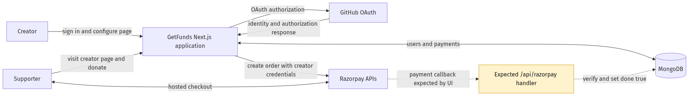

[Open PNG](./png/01-system-context.png) · [Open SVG](./svg/01-system-context.svg) · [Read explanation](../01-high-level-system-diagram.md)

## 2. End-to-end user journey

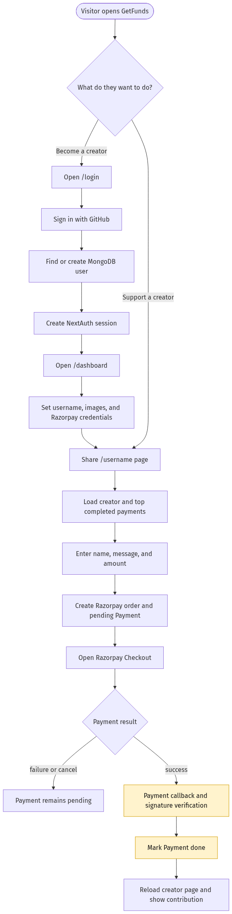

[Open PNG](./png/02-end-to-end-user-journey.png) · [Open SVG](./svg/02-end-to-end-user-journey.svg) · [Read explanation](../02-workflow-diagrams.md#1-end-to-end-user-journey)

## 3. Authentication and onboarding sequence

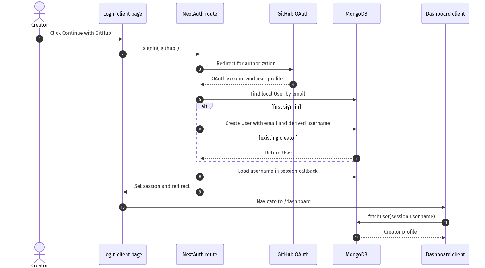

[Open PNG](./png/03-authentication-onboarding-sequence.png) · [Open SVG](./svg/03-authentication-onboarding-sequence.svg) · [Read explanation](../02-workflow-diagrams.md#2-authentication-and-creator-onboarding)

## 4. Creator profile update sequence

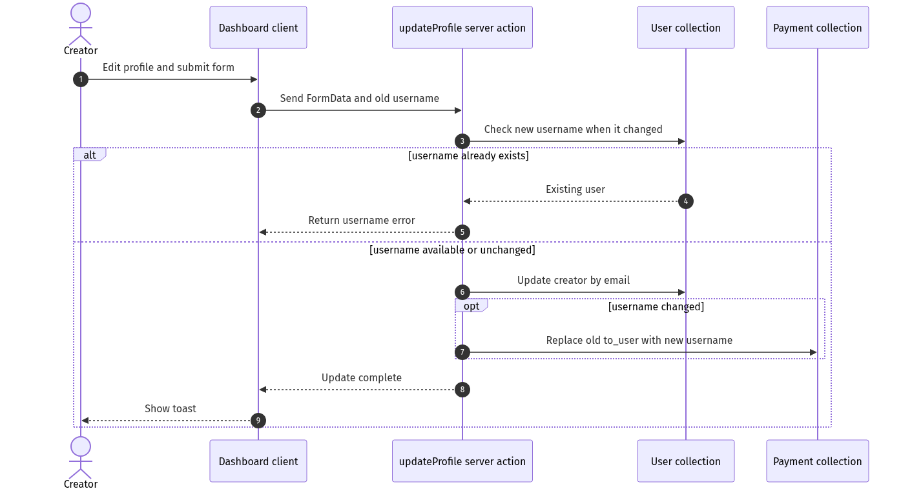

[Open PNG](./png/04-creator-profile-update-sequence.png) · [Open SVG](./svg/04-creator-profile-update-sequence.svg) · [Read explanation](../02-workflow-diagrams.md#3-creator-profile-update)

## 5. Public creator-page read sequence

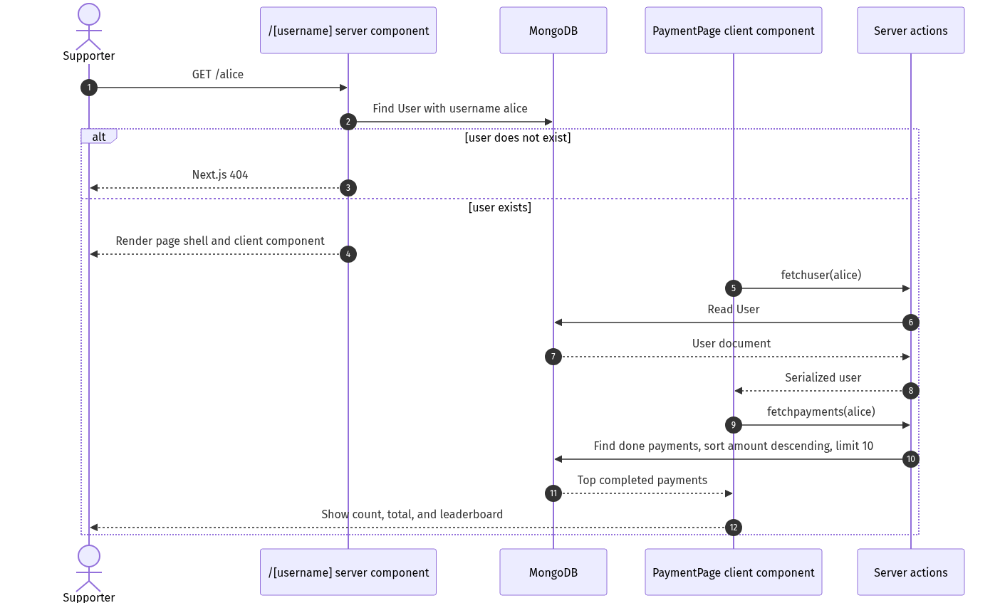

[Open PNG](./png/05-public-creator-page-read-sequence.png) · [Open SVG](./svg/05-public-creator-page-read-sequence.svg) · [Read explanation](../02-workflow-diagrams.md#4-public-creator-page-read-workflow)

## 6. Payment initiation and completion sequence

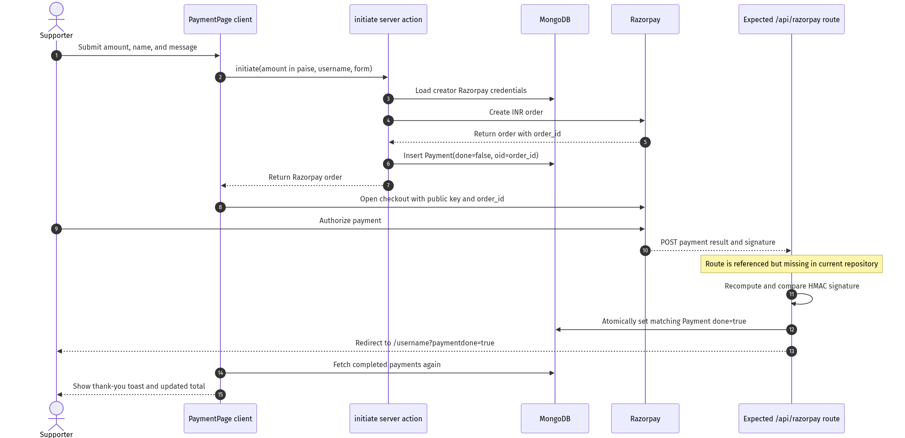

[Open PNG](./png/06-payment-initiation-completion-sequence.png) · [Open SVG](./svg/06-payment-initiation-completion-sequence.svg) · [Read explanation](../02-workflow-diagrams.md#5-payment-initiation-and-intended-completion)

## 7. Payment state machine

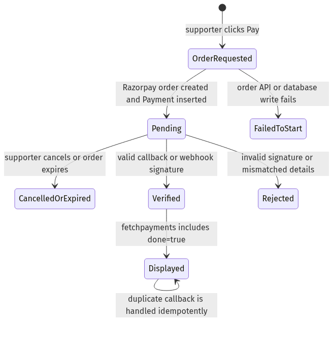

[Open PNG](./png/07-payment-state-machine.png) · [Open SVG](./svg/07-payment-state-machine.svg) · [Read explanation](../02-workflow-diagrams.md#6-payment-state-machine)

## 8. Component architecture

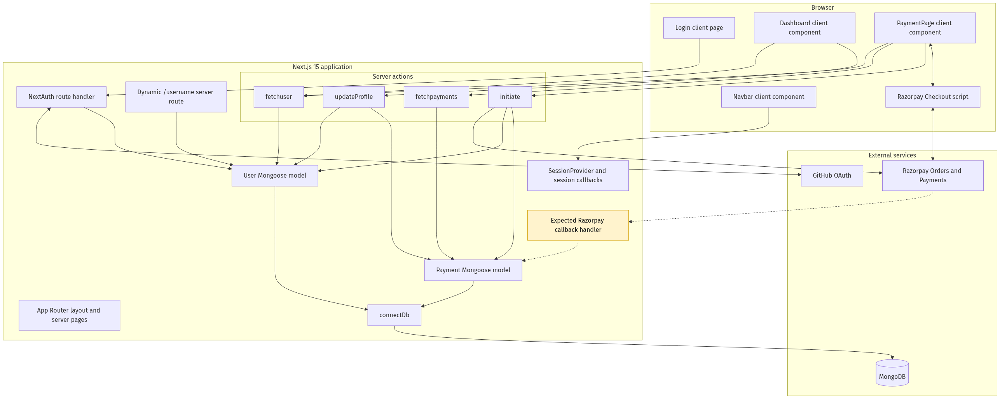

[Open PNG](./png/08-component-architecture.png) · [Open SVG](./svg/08-component-architecture.svg) · [Read explanation](../03-architecture-diagram.md#component-architecture)

## 9. Client/server execution boundary

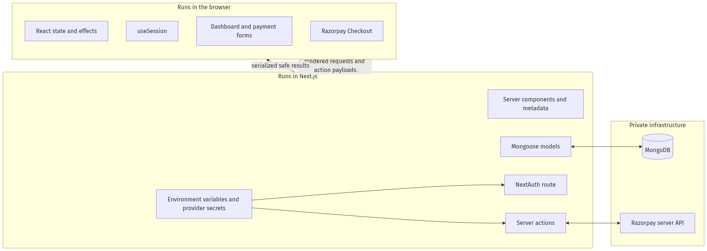

[Open PNG](./png/09-client-server-boundary.png) · [Open SVG](./svg/09-client-server-boundary.svg) · [Read explanation](../03-architecture-diagram.md#clientserver-execution-boundary)

## 10. Data architecture

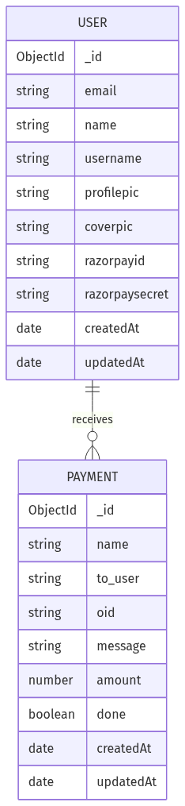

[Open PNG](./png/10-data-architecture.png) · [Open SVG](./svg/10-data-architecture.svg) · [Read explanation](../03-architecture-diagram.md#data-architecture)

## 11. Interview system flow

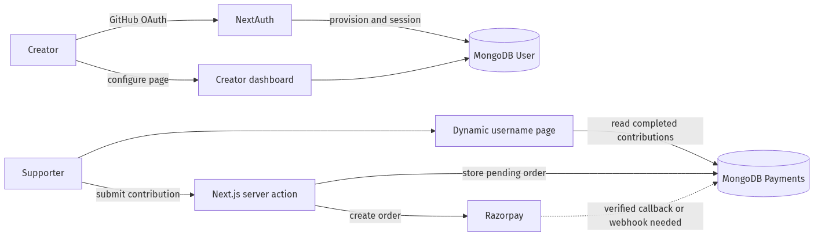

[Open PNG](./png/11-interview-system-flow.png) · [Open SVG](./svg/11-interview-system-flow.svg) · [Read explanation](../04-resume-and-interview-guide.md#system-flow-to-draw-in-an-interview)

## 12. Interview data model

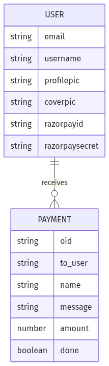

[Open PNG](./png/12-interview-data-model.png) · [Open SVG](./svg/12-interview-data-model.svg) · [Read explanation](../04-resume-and-interview-guide.md#data-model-explanation)

## 13. Production payment workflow

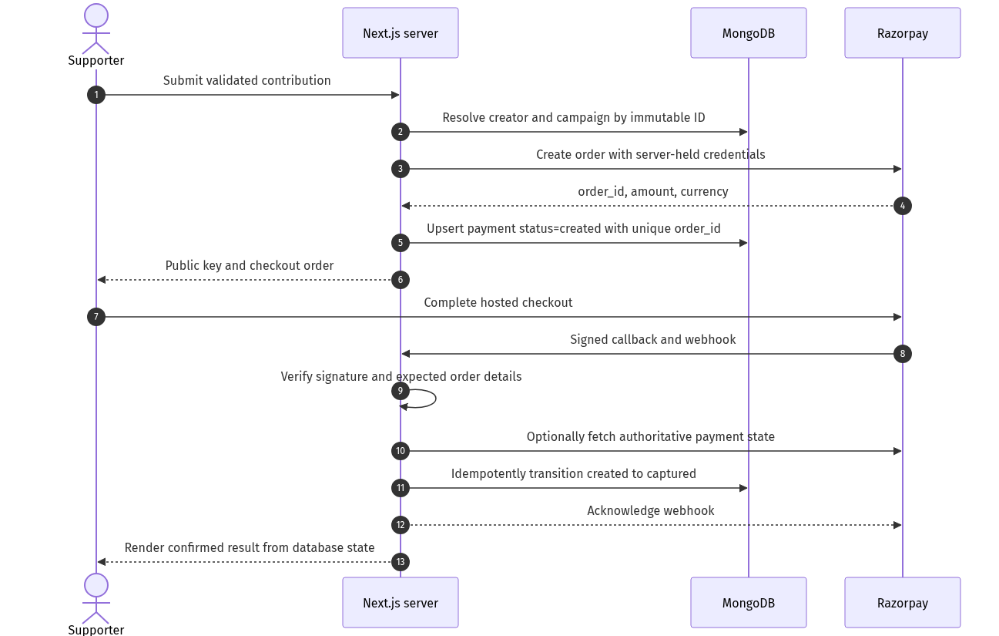

[Open PNG](./png/13-production-payment-workflow.png) · [Open SVG](./svg/13-production-payment-workflow.svg) · [Read explanation](../04-resume-and-interview-guide.md#suggested-production-payment-workflow)
